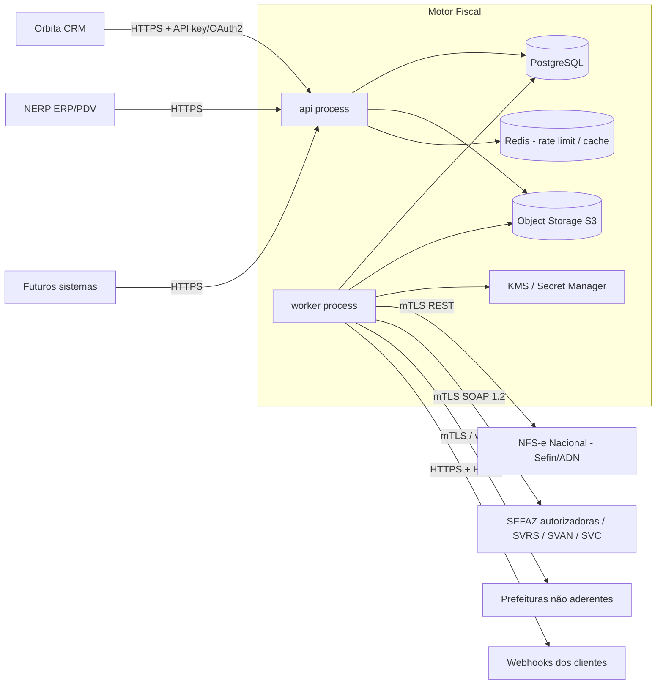
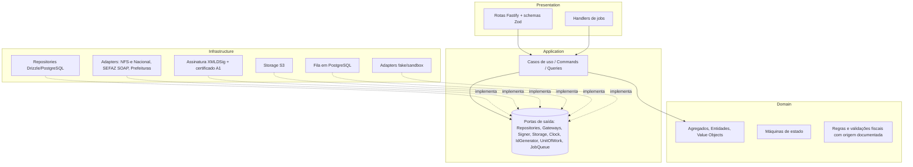

# 01 — Proposta de Arquitetura

> Status: **Proposta (Fase 0)** — aguardando aprovação.
> Data: 2026-11-09

## 1. Resumo executivo

O Motor Fiscal será um **monólito modular** em TypeScript/Node.js, organizado em
**bounded contexts** independentes, cada um estruturado em **Arquitetura Hexagonal**
(domain → application → infrastructure/presentation). Ele é implantado como
**dois tipos de processo** a partir do mesmo código:

| Processo | Responsabilidade |
|---|---|
| `api` | Recebe requisições HTTP (Fastify), autentica a aplicação cliente, resolve o tenant, valida entrada, persiste a intenção de emissão e **enfileira** o trabalho na mesma transação. Nunca fala com SEFAZ/prefeitura no caminho síncrono da requisição de emissão. |
| `worker` | Consome jobs persistentes, monta/assina XML, transmite aos autorizadores, classifica o resultado, consulta situação em caso de dúvida, armazena artefatos, dispara webhooks e executa reconciliações periódicas. |

Motivos para monólito modular (e não microsserviços) estão no
[ADR-0001](../adr/0001-monolito-modular.md). Em resumo: equipe pequena, domínio ainda
sendo descoberto, necessidade de transações locais fortes (emissão + numeração +
fila). Os limites entre módulos são reforçados por regras de lint/dependência, o que
permite extrair um contexto para um serviço próprio no futuro sem reescrever o domínio.

## 2. Visão de contexto (C4 — nível 1)

## 3. Arquitetura hexagonal por contexto

Regras de dependência (verificadas no CI por `dependency-cruiser` ou ESLint
`import/no-restricted-paths`):

1. `domain` não importa nada fora de `domain` e de `shared/domain` (nem Drizzle, nem Fastify, nem Zod, nem `node:crypto`).
2. `application` importa `domain` e declara **portas** (interfaces). Não importa `infrastructure` nem `presentation`.
3. `infrastructure` e `presentation` importam `application`/`domain`. Nunca o contrário.
4. Um contexto só acessa outro por sua **API pública de aplicação** (`modules/<ctx>/public.ts`) — nunca por suas tabelas ou entidades internas.
5. A composição (injeção de dependências) acontece apenas em `src/main/` (composition root), com fábricas explícitas — **sem container de DI mágico** (ver [ADR-0002](../adr/0002-hexagonal-ddd.md)).

## 4. Stack

| Camada | Escolha | Observação |
|---|---|---|
| Linguagem/Runtime | TypeScript (strict) em Node.js LTS (22.x ou 24.x — confirmar LTS ativo na Fase 1) | ESM |
| HTTP | Fastify + `fastify-type-provider-zod` + `@fastify/swagger` | OpenAPI gerado a partir dos schemas Zod |
| Validação | Zod (apenas em `presentation` e config). O domínio valida por si mesmo em VOs. | |
| Banco | PostgreSQL 16+ | RLS por tenant como defesa em profundidade |
| ORM / Migrations | Drizzle ORM + Drizzle Kit (migrations SQL versionadas e revisadas) | só em `infrastructure` |
| Fila | **PostgreSQL** (pg-boss ou implementação própria com `FOR UPDATE SKIP LOCKED`) | ver [ADR-0005](../adr/0005-fila-em-postgresql.md) |
| Redis | **Adiado** (ADR-0020): entra quando houver mais de uma instância de API ou necessidade comprovada | **nunca** guarda estado fiscal |
| Object storage | S3-compatível externo à VPS (recomendado Backblaze B2; SeaweedFS/Garage em dev) com versionamento e Object Lock | [ADR-0010](../adr/0010-armazenamento-xml-s3.md) |
| Hospedagem | VPS Hostinger + Coolify; containers `api`, `worker-fiscal`, `worker-general`, `postgres` | [ADR-0020](../adr/0020-infra-vps-coolify.md) |
| Decimais | `decimal.js` (ou `big.js`) encapsulado em VO `Decimal`/`Money` | **nunca** `number` para valores fiscais |
| XML | gerador determinístico + `xml-crypto` (XMLDSig) + validação XSD (libxml2 via binding/wasm) | escolha final após *spike* ([ADR-0014](../adr/0014-xml-assinatura.md)) |
| Logs | pino (JSON) com redaction | |
| Métricas/Tracing | OpenTelemetry + Prometheus | |
| Testes | Vitest + Testcontainers (PostgreSQL, MinIO) + fast-check | |
| Container | Docker multi-stage, imagem distroless/slim, usuário não-root | |
| CI | GitHub Actions | lint, typecheck, testes, regras de dependência, auditoria de pacotes |

## 5. Decisões centrais de confiabilidade (resumo)

1. **A requisição de emissão é assíncrona por padrão**: `POST` retorna `202 Accepted` com o id do documento e status `PENDING`. O cliente acompanha por webhook ou `GET`.
   - Um modo "aguardar até N segundos" (`Prefer: wait=10`) pode ser oferecido para PDV (NFC-e), mas ele só *espera* o worker — não transmite no thread HTTP.
2. **Idempotência em duas camadas**: (a) `Idempotency-Key` por aplicação cliente + tenant; (b) chave natural fiscal (série/número, chave de acesso, id da DPS) com constraints `UNIQUE` no banco.
3. **Numeração reservada transacionalmente** no momento da aceitação, nunca no momento da transmissão.
4. **Estado `UNKNOWN` explícito**: qualquer falha após possível entrega ao autorizador leva a `UNKNOWN`, e a única saída de `UNKNOWN` é uma **consulta** ao autorizador. Retransmissão só depois de a consulta provar que o documento não existe lá.
5. **Fila e mudança de estado na mesma transação** (outbox implícito por usar PostgreSQL como fila).
6. **Auditoria append-only** de toda transição de estado, tentativa e uso de certificado.

## 6. O que o motor faz e o que ele (inicialmente) não faz

| Faz | Não faz (por ora) — decisão a confirmar |
|---|---|
| Valida estrutura, obrigatoriedade, consistência aritmética (totais = soma dos itens, etc.) e regras de schema/MOC/NT documentadas | **Determinar** a tributação (escolher CST/CSOSN, alíquotas, benefícios, NCM/CFOP corretos). Isso fica com o sistema cliente/contador, que envia os valores. Ver [ADR-0018](../adr/0018-escopo-calculo-tributario.md). |
| Gera, assina, transmite, consulta, cancela, armazena | Escrituração (SPED), apuração, guias |
| Gera DANFE/DANFE NFC-e/DANFSe quando aplicável | Gestão comercial (pedidos, estoque) |

Essa separação é a mais importante do projeto do ponto de vista de risco: um motor de
**emissão** é tratável; um motor de **determinação tributária** para todos os regimes,
UFs, municípios e a transição da Reforma Tributária é um produto inteiro à parte.
