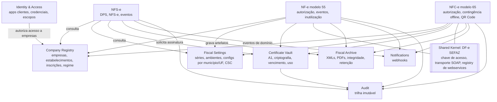

# 02 — Bounded Contexts

## Mapa de contextos

## Descrição dos contextos

### 1. Identity & Access (`iam`)
- **Responsabilidade**: cadastro das aplicações consumidoras (Orbita, NERP…), credenciais (API keys / OAuth2 client credentials), escopos (`nfse:issue`, `nfe:cancel`, `certificates:manage`…) e **concessões** aplicação → empresa.
- **Linguagem**: `ClientApplication`, `Credential`, `Scope`, `CompanyGrant`.
- **Regra-chave**: a empresa de uma requisição é derivada da credencial + concessão, nunca do CNPJ enviado. O CNPJ do payload é **conferido** contra a empresa resolvida.

### 2. Company Registry (`company`)
- **Responsabilidade**: o contribuinte (empresa) e seus estabelecimentos.
- **Linguagem**: `Company` (empresa raiz), `Establishment` (matriz/filial, CNPJ próprio), `StateRegistration` (IE por UF), `MunicipalRegistration` (IM), `TaxRegime` (Simples Nacional, Simples excesso sublimite, Regime Normal, MEI — conforme códigos CRT oficiais), `Address`.
- **Observação**: um grupo econômico com várias filiais = uma empresa com vários estabelecimentos; cada documento é emitido por **um estabelecimento**.

### 3. Fiscal Settings (`fiscal-settings`)
- **Responsabilidade**: configuração operacional de emissão por estabelecimento e modalidade.
- **Linguagem**: `DocumentSeries` (modalidade + série + próximo número), `Environment` (produção/homologação), `NfseMunicipalSetup` (município, padrão: nacional ou provedor X, credenciais específicas), `NfceCsc` (id + CSC — segredo), `ContingencyPolicy`.
- **Por que separado**: muda com frequência diferente dos documentos e é compartilhado por vários contextos de documento.

### 4. Certificate Vault (`certificates`)
- **Responsabilidade**: upload, validação (cadeia ICP-Brasil, titularidade CNPJ, validade), armazenamento criptografado, disponibilização efêmera para assinatura e mTLS, alertas de vencimento, auditoria de uso.
- **Porta pública**: `CertificateVault.withCertificate(establishmentId, purpose, fn)` — a chave privada nunca sai do escopo dessa função nem é serializada.

### 5. NFS-e (`nfse`)
- **Responsabilidade**: ciclo de vida da DPS/NFS-e, eventos (cancelamento, substituição — conforme padrão), tratamento de rejeições, consulta.
- **Subdivisão por adapter**: padrão nacional (Sefin Nacional / ADN) como adapter principal; provedores municipais (ABRASF e derivados) como adapters adicionais **quando um município exigir**. O domínio NFS-e modela conceitos do **padrão nacional**; adapters municipais traduzem.

### 6. NF-e (`nfe`) e 7. NFC-e (`nfce`)
- **Contextos distintos**, embora usem o mesmo leiaute base (`NFe` v4.00 com `mod` 55 ou 65). As diferenças de regras (destinatário, contingência offline, QR Code, CSC, prazos de cancelamento, DANFE, inutilização, eventos permitidos) justificam domínios separados.
- **Shared Kernel `dfe-sefaz`**: apenas o que é comprovadamente idêntico: VO `AccessKey` (44 posições + DV módulo 11), cliente SOAP/mTLS, registro de URLs de webservices por UF/ambiente/serviço/versão, parser de retornos `cStat/xMotivo`, consulta de status do serviço. Alterações no kernel exigem revisão dos dois contextos.

### 8. Fiscal Archive (`archive`)
- **Responsabilidade**: armazenar e recuperar artefatos (XML enviado, assinado, protocolo, `procNFe`/documento autorizado, eventos, PDFs, respostas brutas), com hash SHA-256, metadados no PostgreSQL, conteúdo no S3, retenção e controle de acesso.

### 9. Notifications (`notifications`)
- **Responsabilidade**: assinaturas de webhook por aplicação/empresa, entrega com HMAC, retentativas, DLQ, reenvio manual.
- Consome **eventos de integração** publicados pelos contextos de documentos (`fiscal_document.authorized`, `.rejected`, `.cancelled`, `.failed`, `.status_changed`).

### 10. Audit (`audit`)
- **Responsabilidade**: trilha append-only (quem, qual aplicação, qual empresa, o quê, quando, correlation id, hash encadeado). Sem UPDATE/DELETE (permissão de banco + trigger).

## Relações e padrões de integração

| De → Para | Padrão | Mecanismo |
|---|---|---|
| Documentos → Company/Settings | Customer/Supplier, leitura | chamada síncrona à API pública de aplicação; documento grava **snapshot** dos dados do emitente usados (o cadastro pode mudar depois) |
| Documentos → Certificates | Open Host Service | porta `CertificateVault` |
| Documentos → Notifications/Audit | Eventos publicados | evento gravado na mesma transação (outbox) |
| NFS-e → Prefeituras | Anticorruption Layer | adapters traduzem modelo nacional ↔ provedor |
| NF-e/NFC-e → SEFAZ | Anticorruption Layer + Shared Kernel | `dfe-sefaz` |
