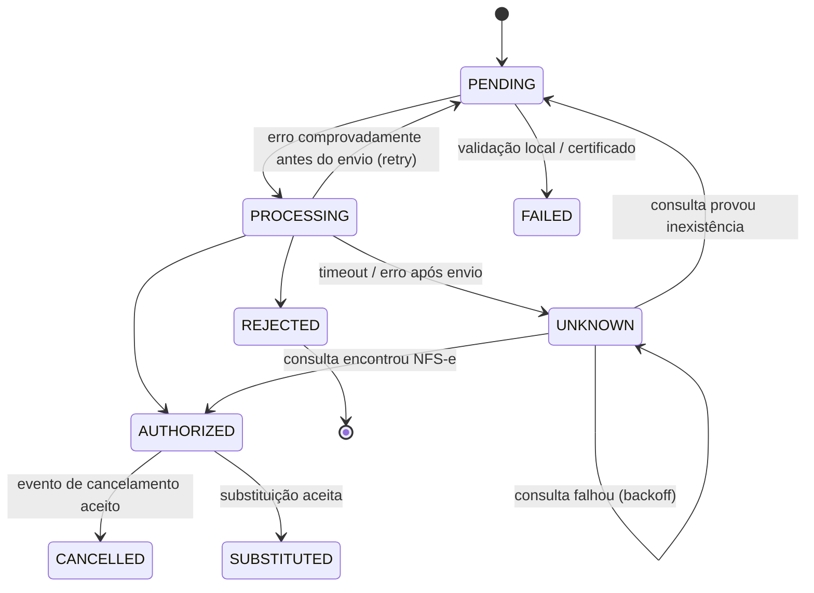
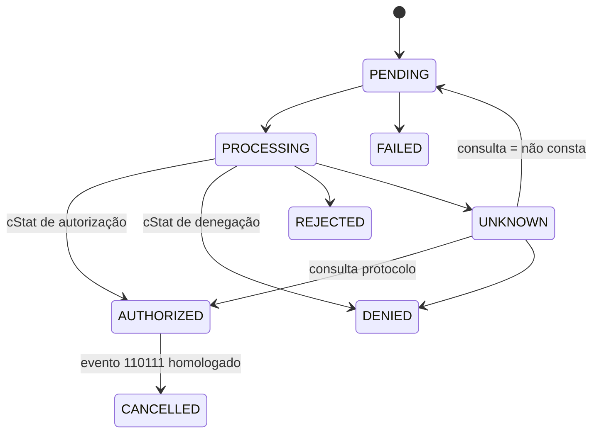

# 04 — Modelo inicial de domínio

> Os campos fiscais citados aqui são **ilustrativos do conceito**. A lista definitiva
> de campos, tamanhos e obrigatoriedades virá dos XSDs/manuais oficiais na fase de
> cada documento, com origem registrada em `docs/fiscal/regras/`.

## 1. Shared domain (Value Objects)

| VO | Invariantes | Observação |
|---|---|---|
| `Cnpj` | 14 posições, DV válido | **Deve suportar o CNPJ alfanumérico** (IN RFB nº 2.229/2024, vigente a partir de jul/2026). Cálculo do DV alfanumérico conforme especificação da RFB. Impacto na chave de acesso e nos leiautes DF-e: verificar NT específica (ver R-10). |
| `Cpf` | 11 dígitos, DV válido | |
| `Decimal` / `Money` | precisão arbitrária; escala explícita por campo | valores unitários e quantidades têm escalas diferentes dos totais — definidas pelo XSD |
| `Uf`, `MunicipalityCode` (IBGE 7 dígitos) | pertence à tabela oficial versionada | |
| `Environment` | `PRODUCTION` \| `HOMOLOGATION` | documento herda da empresa/config e **nunca muda** |
| `CorrelationId`, `IdempotencyKey` | | |
| `DocumentNumber`, `SeriesNumber` | limites conforme leiaute de cada modalidade | |
| `IssueDateTime` | data/hora com offset (fuso do emitente) | rejeições por horário são comuns: relógio sincronizado (NTP) é requisito de infra |

## 2. Agregados por contexto

### Company
```
Company (aggregate root, = empresa)
 ├─ id, legalName, rootCnpj (8 primeiras posições), status
 └─ Establishment[] (aggregate root próprio, referenciado por id)
      ├─ cnpj, tradeName, address
      ├─ stateRegistrations[] (Uf + IE | "ISENTO")
      ├─ municipalRegistration (IM)
      └─ taxRegime (CRT oficial) + validFrom   ← histórico, não sobrescrever
```

### Fiscal Settings
```
DocumentSeries (aggregate root)
 ├─ establishmentId, documentKind (NFSE|NFE|NFCE), environment, series
 ├─ nextNumber              ← alocação atômica (UPDATE ... RETURNING)
 └─ status (ACTIVE|BLOCKED)
NfseMunicipalSetup: establishmentId, municipality, integrationStandard (NATIONAL | <provedor>), credentials (segredo)
NfceCsc: establishmentId, uf, cscId, cscSecret (segredo), validFrom
```

### Certificates
```
DigitalCertificate (aggregate root)
 ├─ establishmentId (ou companyId para certificado da matriz usado pelas filiais — regra a confirmar por modalidade)
 ├─ type: A1
 ├─ subjectCnpj, serialNumber, issuer, notBefore, notAfter, thumbprintSha256
 ├─ encryptedPfx (bytea) + wrappedDek + kekId   ← nunca o PFX em claro (ADR-0009)
 ├─ encryptedPassword (mesma DEK, registro separado)
 └─ status: PENDING_VALIDATION | ACTIVE | REJECTED | EXPIRED | REVOKED | REPLACED
```

### NFS-e
```
ServiceInvoice (aggregate root)
 ├─ id (UUID v7), companyId, establishmentId, clientApplicationId
 ├─ idempotencyKey
 ├─ environment, integrationStandard
 ├─ dps: Dps (VO grande, imutável após aceitação)
 │    ├─ series, number, issueDateTime, competence
 │    ├─ provider snapshot, taker (tomador), intermediary?
 │    ├─ service (código de tributação nacional, código municipal?, descrição, local da prestação)
 │    └─ values (valor do serviço, deduções, tributos informados — inclui IBS/CBS quando exigido)
 ├─ dpsId (identificador da DPS — composição conforme manual nacional)
 ├─ status: ServiceInvoiceStatus
 ├─ authorization?: { nfseAccessKey, nfseNumber, authorizedAt, ... }
 ├─ rejection?: { code, message, raw }
 ├─ attempts: ProcessingAttempt[]  (entidade; persistida em tabela própria)
 ├─ events: ServiceInvoiceEvent[]  (cancelamento, substituição)
 └─ ruleSetVersion, layoutVersion  ← congelados na aceitação
```

### NF-e / NFC-e
```
ProductInvoice (NF-e) / ConsumerInvoice (NFC-e)  — agregados distintos
 ├─ id, companyId, establishmentId, idempotencyKey, environment
 ├─ series, number, accessKey (gerada pelo emissor: inclui cNF aleatório e DV)
 ├─ emissionType (normal, SVC-AN, SVC-RS, EPEC, offline NFC-e … — conforme MOC)
 ├─ payload: NfeData (ide, emit snapshot, dest, det[], total, transp, pag, infAdic, IBS/CBS…)
 ├─ status
 ├─ authorizationProtocol?: { nProt, dhRecbto, cStat, digVal }
 ├─ attempts[], events[] (cancelamento, CC-e — só NF-e, ...)
 └─ ruleSetVersion, layoutVersion
NumberRangeVoiding (inutilização) — agregado separado: series, from, to, justification, status, protocol
```

## 3. Máquinas de estado

Estados internos comuns ao vocabulário do projeto, mas **cada modalidade define suas transições** e pode ter estados próprios que existam fiscalmente.

| Estado | Significado preciso |
|---|---|
| `PENDING` | aceito pelo motor, numeração reservada, ainda não transmitido |
| `PROCESSING` | um worker detém o lock e está montando/transmitindo/aguardando resposta |
| `AUTHORIZED` | autorizador retornou autorização com protocolo/identificação válidos |
| `REJECTED` | autorizador retornou rejeição definitiva (código oficial guardado) |
| `DENIED` | **(NF-e/NFC-e)** uso denegado — situação fiscal real, distinta de rejeição; número consumido |
| `CANCELLED` | evento de cancelamento homologado pelo autorizador |
| `SUBSTITUTED` | **(NFS-e)** substituída por outra NFS-e já autorizada (implementado, ADR-0036) |
| `FAILED` | falha definitiva **comprovadamente anterior a qualquer transmissão** (ex.: certificado vencido, validação XSD local falhou, dados inconsistentes) |
| `UNKNOWN` | pode ter chegado ao autorizador e não sabemos o resultado. Saída **somente por consulta** |
| `CONTINGENCY_PENDING_SYNC` | **(NFC-e/NF-e em contingência)** emitido em contingência, pendente de transmissão/regularização |

Regra: `FAILED` nunca é usado se houve qualquer possibilidade de entrega. Na dúvida → `UNKNOWN`.

### NFS-e (padrão nacional — a validar contra o manual)


### NF-e (simplificado; contingência detalhada na Fase 4)


Os eventos de cancelamento e CC-e são **entidades com estado próprio**
(`REQUESTED → PROCESSING → REGISTERED | REJECTED | UNKNOWN`). O documento só passa a
`CANCELLED` quando o evento é registrado. Códigos de evento e de `cStat` citados devem
ser confirmados no MOC/NT vigente antes da implementação.

## 4. Eventos de domínio (exemplos)
`ServiceInvoiceAccepted`, `ServiceInvoiceAuthorized`, `ServiceInvoiceRejected`,
`ServiceInvoiceOutcomeUnknown`, `ServiceInvoiceCancelled`, `CertificateExpiringSoon`,
`CertificateUsed`. Eventos de domínio viram **eventos de integração** (webhooks) com
contrato público versionado separado.
