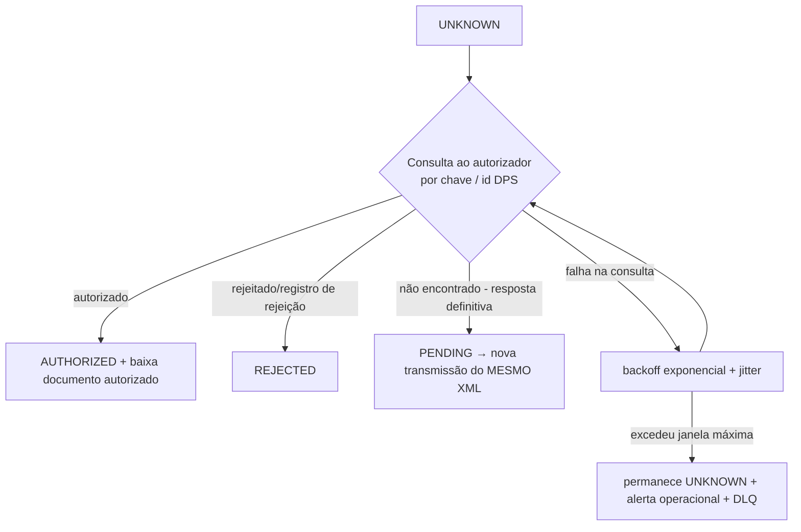

# 05 — Principais fluxos de negócio

## F1. Emissão (genérico, aplicado a NFS-e na Fase 2)

```mermaid
sequenceDiagram
  autonumber
  participant C as Sistema cliente
  participant A as API
  participant DB as PostgreSQL
  participant W as Worker
  participant V as Certificate Vault
  participant G as Gateway (autorizador)
  participant S as S3

  C->>A: POST /v1/service-invoices (Idempotency-Key)
  A->>A: autentica app, resolve tenant, valida schema (Zod)
  A->>DB: BEGIN
  A->>DB: busca idempotency_key (tenant, app, key)
  alt chave já existe com mesmo hash de payload
    A-->>C: 200/202 com o mesmo documento (replay)
  else chave existe com payload diferente
    A-->>C: 422 IDEMPOTENCY_KEY_REUSED
  else nova
    A->>A: domínio valida regras (invariantes, totais)
    A->>DB: reserva número (UPDATE document_series ... RETURNING)
    A->>DB: INSERT documento PENDING + snapshot emitente + versão de regras
    A->>DB: INSERT job "submit" + evento outbox + audit
    A->>DB: COMMIT
    A-->>C: 202 { id, status: PENDING }
  end
  W->>DB: pega job (SKIP LOCKED), documento PENDING → PROCESSING (versão otimista)
  W->>V: withCertificate(...)
  W->>W: gera XML/payload, valida XSD, assina
  W->>S3: grava XML assinado (hash)
  W->>DB: registra attempt (started, payloadHash)
  W->>G: transmite
  alt resposta definitiva
    G-->>W: autorizado / rejeitado
    W->>S3: grava resposta bruta + documento autorizado
    W->>DB: BEGIN; estado final; attempt fechada; outbox webhook; audit; COMMIT
  else timeout/erro após envio
    W->>DB: estado UNKNOWN; agenda job "reconcile" com backoff
  else erro antes do envio (DNS, conexão recusada, cert inválido)
    W->>DB: volta a PENDING (retry com backoff) ou FAILED (se permanente)
  end
```

Pontos críticos:
- O XML assinado é **gerado uma vez** e reutilizado em retentativas do mesmo documento (mesma chave/DPS id), salvo quando o manual exige novo envio com dados alterados.
- A data/hora de emissão é congelada na aceitação; se o autorizador rejeitar por defasagem de horário, isso é tratado como rejeição explícita, não como regeneração silenciosa (decisão por modalidade, a confirmar no manual).

## F2. Recuperação de estado `UNKNOWN`



- "Não encontrado" só conta como prova se a semântica oficial do serviço de consulta garantir isso. Para serviços com processamento assíncrono (recibo/lote), consultar primeiro o recibo.
- **Nunca** um job transforma `UNKNOWN` em `FAILED`. Somente um operador humano, com evidência, via comando auditado.

## F3. Cancelamento

1. `POST /v1/service-invoices/{id}/cancellation` com motivo/justificativa (regras de tamanho e códigos de motivo conforme manual).
2. Domínio verifica: documento `AUTHORIZED`, prazo/condições da modalidade (fonte documentada), sem cancelamento em andamento.
3. Cria `CancellationEvent(REQUESTED)` + job, idempotente por documento.
4. Worker assina e transmite evento → `REGISTERED` (documento → `CANCELLED`) | `REJECTED` (documento continua `AUTHORIZED`) | `UNKNOWN` (consulta de eventos do documento).
5. Webhook `fiscal_document.cancelled`.

## F4. Cadastro e certificado

1. App com escopo `tenants:manage` cria tenant/estabelecimento (CNPJ validado; opcionalmente conferência cadastral futura).
2. Upload do PFX + senha via endpoint dedicado (multipart, limite de tamanho, TLS).
3. Validação: abre PKCS#12 em memória, verifica par chave/cert, cadeia ICP-Brasil, validade, CNPJ do titular vs estabelecimento (raiz do CNPJ para filiais — regra por modalidade a confirmar).
4. Criptografa (envelope), grava blob no S3/banco, zera buffers, audita. Senha nunca retorna em nenhuma API.
5. Job diário de vencimento: alertas em 30/15/7/1 dias (configurável) + webhook `certificate.expiring`.

## F5. Reconciliação periódica

- Job agendado varre: documentos `UNKNOWN`, `PROCESSING` com lease expirado (worker morreu), eventos pendentes, `CONTINGENCY_PENDING_SYNC`.
- Para cada um, aplica F2. Métrica `documents_stuck_total{status,kind}` e alerta.

## F6. Entrega de webhook

1. Evento de integração gravado em `outbox` na transação da mudança de estado.
2. Dispatcher cria `webhook_deliveries` por assinatura ativa.
3. POST com headers `Webhook-Id`, `Webhook-Timestamp`, `Webhook-Signature` (HMAC-SHA256 sobre `id.timestamp.body`).
4. 2xx = entregue; outro = retry exponencial (ex.: até 24h); depois DLQ + reenvio manual via API.
5. Consumidor deduplica por `Webhook-Id` (documentado no contrato). Payload **não** contém XML, só ids e status; o cliente busca detalhes via API (evita vazar dados por URL mal configurada).

## F7. NFC-e com contingência offline (Fase 3 — esboço)

- Em contingência offline, a NFC-e é emitida e entregue ao consumidor **sem** autorização prévia, e deve ser transmitida depois dentro do prazo legal (a confirmar na legislação/NT vigente da UF).
- Se o PDV estiver sem internet, **um motor em nuvem não consegue emitir**. Exige componente local (ver risco R-07 e ADR-0019).
