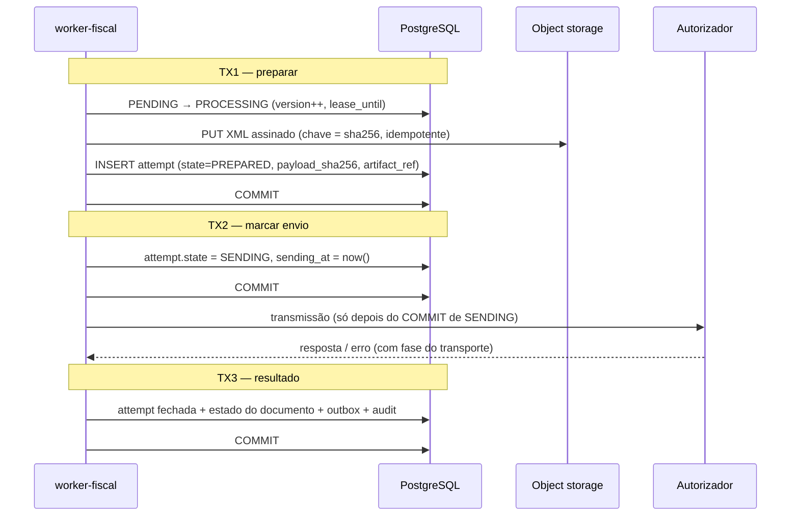
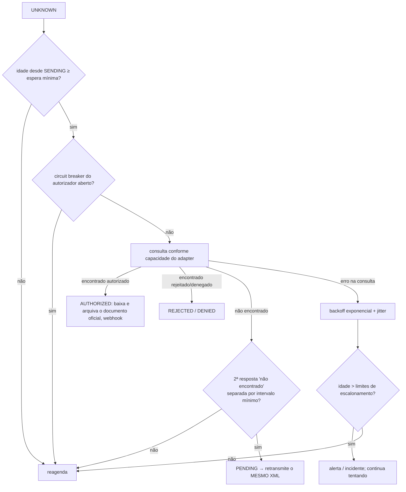

# 12 — Recuperação de emissões em estado UNKNOWN (aprofundamento)

## 1. Invariantes
1. Um documento entra em `UNKNOWN` sempre que **pode** ter chegado ao autorizador sem que tenhamos resposta definitiva.
2. Enquanto estiver em `UNKNOWN`, o documento **mantém** número, série, identificador (DPS id / chave de acesso) e XML assinado. Nada disso é regenerado.
3. A única saída automática é uma **consulta** ao autorizador. Retransmissão só depois de provar que o documento não existe lá, e com o **mesmo** XML assinado.
4. Nenhum job transforma `UNKNOWN` em `FAILED`. Só um operador, com evidência, por comando auditado.
5. Repetir a requisição do cliente (mesma `Idempotency-Key`) devolve o mesmo documento, nunca cria outro.

## 2. Protocolo de tentativa com registro prévio (write-ahead)

O ponto crítico é saber, depois de uma queda, se a transmissão **começou**. Por isso cada tentativa grava seu estado **antes** de qualquer chamada de rede:



| Onde o processo caiu | Estado no banco | Interpretação na recuperação |
|---|---|---|
| Antes do COMMIT da TX1 | `PENDING`, sem attempt | Nada aconteceu → job reprocessa normalmente |
| Depois da TX1, antes da TX2 | `PROCESSING` + attempt `PREPARED` | **Certeza** de não envio → volta a `PENDING` |
| Depois da TX2 (com ou sem resposta) | `PROCESSING` + attempt `SENDING` | **Pode ter sido enviado** → `UNKNOWN` |
| Depois da TX3 | estado final | nada a fazer |

O *stuck-scan* (a cada 1 min) aplica essa tabela a documentos com `lease_until` vencido.

### Classificação de erro de transporte
O cliente HTTP (undici com hooks de diagnóstico) informa a fase da falha:

| Fase | Resultado |
|---|---|
| `dns`, `connect`, `tls-handshake` (antes de escrever qualquer byte do corpo) | `NOT_SENT` → volta a `PENDING` com backoff |
| `request-write` iniciado, `response-wait`, `response-read`, reset, timeout | `UNKNOWN` |
| HTTP 5xx, SOAP Fault genérico, corpo ilegível | `UNKNOWN` (conservador) |
| Resposta oficial "duplicidade" | não é rejeição: dispara consulta imediata |

Se houver qualquer dúvida sobre a fase, a classificação é `UNKNOWN`. Um teste de contrato garante que **não existe caminho de código** que devolva `NOT_SENT` depois de o corpo começar a ser escrito.

## 3. Algoritmo de reconciliação



- **Duas respostas "não encontrado" espaçadas**: protege contra processamento ainda em andamento no autorizador (consistência eventual). Valores iniciais configuráveis: espera mínima de 2 min após `SENDING`; segunda consulta após mais 5 min. Ajustados por medição em homologação.
- **Retransmissão do mesmo XML**: se o autorizador processou entretanto, a chave/DPS id repetida tende a produzir resposta de duplicidade, que volta a disparar consulta. Comportamento exato de duplicidade a confirmar em cada manual.
- Backoff da consulta: 1 min, 2 min, 5 min, 10 min, 30 min, depois 1 h até 72 h; rate limit por autorizador e por CNPJ para não caracterizar consumo indevido.

## 4. Capacidade de consulta por adapter
Cada adapter declara o que sabe fazer; o reconciliador se adapta:

```ts
interface GatewayCapabilities {
  lookupByClientId: boolean;     // NFS-e Nacional: API DPS (id da DPS → chave) — manual v1.2, leitura pendente
  lookupByAccessKey: boolean;    // NF-e/NFC-e: consulta protocolo; NFS-e: consulta pela chave
  lookupByReceipt: boolean;      // NF-e assíncrona: consulta recibo
  duplicateIsDetectable: boolean;
}
```

| Modalidade | Estratégia de consulta (a confirmar na documentação oficial de cada fase) |
|---|---|
| NFS-e Nacional | consultar pelo id da DPS → se houver chave, baixar a NFS-e pela chave |
| NFS-e municipal Teresina | depende do webservice municipal (consulta por RPS/lote?). Se **não houver consulta confiável**, `lookupByClientId=false` e o `UNKNOWN` vai para fila de resolução manual muito mais cedo |
| NF-e / NFC-e | recibo conhecido → consulta recibo; senão → consulta protocolo pela chave de acesso |

## 5. NFC-e: consumidor esperando no caixa
Para NFC-e, o `UNKNOWN` acontece com o cliente em frente ao caixa. A política (Fase 3, conforme regras da SEFAZ-PI) será definida explicitamente:
- O PDV recebe `UNKNOWN` como "em verificação" e **não** emite outra nota por conta própria.
- Se a operação precisar seguir, entra o fluxo de **contingência oficial** previsto no MOC/NT, com o tratamento formal da nota original caso ela apareça autorizada depois (o MOC prevê evento específico para esse caso — código e regras a confirmar). Nunca uma segunda emissão "normal".

## 6. Escalonamento
| Idade do UNKNOWN | Ação |
|---|---|
| > 15 min | alerta de aviso (métrica + log) |
| > 2 h | alerta crítico; aparece no painel de pendências |
| > 24 h | incidente: análise manual obrigatória |

Métricas: `fiscal_unknown_documents{kind,authority}`, `fiscal_unknown_oldest_age_seconds`, `fiscal_reconcile_attempts_total{result}`.

## 7. Resolução manual
Comando `ResolveUnknownDocument` (escopo `ops:resolve`, somente operador):
- exige resultado alegado (`AUTHORIZED` com chave/protocolo, `NOT_ISSUED`), justificativa e evidência anexada (ex.: print/XML obtido no portal oficial);
- se `AUTHORIZED`, o sistema ainda tenta baixar o documento oficial para arquivar;
- registra auditoria com hash encadeado. Nada é apagado.

## 8. Contrato com os sistemas clientes
- Webhook `fiscal_document.status_changed` com `status: UNKNOWN` significa **"em verificação — não reemita"**.
- O cliente nunca deve criar outro documento com nova `Idempotency-Key` para a mesma venda enquanto houver um documento em `UNKNOWN`. Isso será documentado no guia de integração do Orbita/NERP.
- Proteção extra (opcional, Fase 2): aviso de **suspeita de duplicidade** quando o mesmo estabelecimento envia documento com mesmo tomador, mesmo valor e mesma `externalReference` enquanto outro está em `UNKNOWN`/`PENDING` — o segundo fica retido até confirmação.

## 9. Testes obrigatórios
1. Queda injetada em cada ponto (antes TX1, entre TX1/TX2, após TX2, após resposta) → estado correto após reinício.
2. Simulador "processa e derruba a conexão" → `UNKNOWN` → consulta → `AUTHORIZED` **sem nova transmissão** (contador de recepções do simulador = 1).
3. "Não encontrado" seguido de "encontrado" (consistência eventual) → nunca retransmite antes da 2ª confirmação.
4. Retransmissão após prova de inexistência envia **byte a byte** o mesmo XML (hash igual).
5. Autorizador indisponível por horas → `UNKNOWN` preservado, alertas disparados, nenhum `FAILED`.
6. 50 requisições paralelas com a mesma `Idempotency-Key` durante um `UNKNOWN` → um único documento.
7. Adapter sem consulta confiável → vai para resolução manual no prazo configurado.
