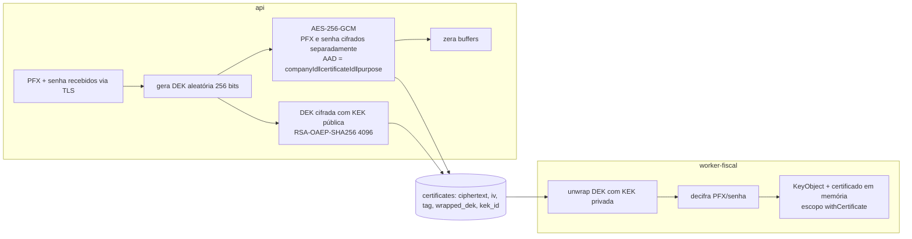

# 13 — Segurança dos certificados A1 (aprofundamento)

## 1. Ameaças consideradas
| Ameaça | Exemplo | Controle principal |
|---|---|---|
| Vazamento por log/erro | stack trace com buffer do PFX, log de request de upload | redaction + serializers + teste "canário" |
| Processo com acesso indevido | API ou worker de webhooks lendo o certificado | separação de privilégios por container + chave assimétrica |
| Dump do banco/backup | backup vazado | material só cifrado; KEK fora do banco |
| Troca de blobs entre empresas | ciphertext da empresa A usado para B | AAD com empresa + certificado |
| Uso indevido do certificado | emissão não autorizada | uso só via fluxo de documento, auditoria de cada uso |
| Perda da KEK | todos os certificados ficam ilegíveis | backup offline da KEK, re-upload pelos clientes |
| Acesso root à VPS | leitura de memória/variáveis | **risco residual**: mitigado por hardening e acesso restrito; documentado |

## 2. Separação de privilégios por processo

| Container | Tem a chave de abertura (KEK privada)? | Lê ciphertext no banco? | Observação |
|---|---|---|---|
| `api` | **Não**. Tem só a KEK **pública** (pode cifrar, não pode decifrar) | **Não** (grants de coluna) | recebe o upload e cifra imediatamente |
| `worker-fiscal` | **Sim** | Sim | único que assina e faz mTLS com SEFAZ/NFS-e |
| `worker-general` | Não | Não | webhooks (chama URLs externas dos clientes), manutenção, alertas |

Por que separar `worker-general`: é ele que faz requisições para URLs de terceiros (webhooks) — a superfície mais exposta a SSRF/abuso. Ele nunca deve ter o material dos certificados na memória. Ver [ADR-0021](../adr/0021-separacao-workers-privilegio.md).

Grants no PostgreSQL:
```sql
-- api: pode inserir certificado e ler apenas metadados
-- (versão implementada: src/db/migrations/0003_security_audit_certificates.sql)
GRANT INSERT (id, company_id, establishment_id, envelope_version, kek_id, wrapped_dek, pfx_sealed, password_sealed) ON certificates TO fiscal_api;
GRANT SELECT (<somente metadados>) ON certificates TO fiscal_api;
GRANT UPDATE (status, wrapped_dek, revoked_at, updated_at) ON certificates TO fiscal_api;  -- revogação
-- worker-fiscal: lê tudo; grava só status e metadados da validação
GRANT SELECT, UPDATE (status, rejection_reason, <metadados>, validated_at, replaced_at, updated_at) ON certificates TO fiscal_worker;
-- worker-general: só metadados para alertas de vencimento
GRANT SELECT (id, company_id, establishment_id, not_after, status) ON certificates TO fiscal_general;
```

## 3. Criptografia por envelope com KEK assimétrica



- **A API nunca consegue decifrar** um certificado, nem mesmo um que ela acabou de receber.
- Cada certificado tem sua DEK; vazar uma DEK não expõe os demais.
- O PFX cifrado (poucos KB) fica no PostgreSQL (coluna `bytea`) — tamanho pequeno justifica; evita uma dependência a mais no caminho crítico de assinatura.
- Algoritmos exatos (RSA-OAEP 4096 vs. X25519 + HKDF) fixados no spike da Fase 1; ambos disponíveis em `node:crypto`.

## 4. Ciclo de vida

1. **Upload** (`POST /v1/establishments/{id}/certificates`, escopo `certificates:manage`, JSON com `pfx` em base64 + `password`, PFX até 50 KB, limite de corpo próprio da rota; rate limit na semana 6): a API cifra, grava com status `PENDING_VALIDATION` e responde 202. O disparo automático da validação pela fila entra na semana 6; até lá, `npm run certificates -- validate`. O corpo da requisição nunca é logado (redact + sanitize + teste canário).
2. **Validação** (worker-fiscal), regra [CERT-001](../fiscal/regras/CERT-001.md): abre o PKCS#12; confere o par chave/certificado; cadeia até as ACs raiz do bundle confiável (ICP-Brasil do ITI em produção, pendente de carga); validade; CNPJ do titular no otherName **2.16.76.1.3.3** (DOC-ICP-04) com a mesma raiz da empresa; `digitalSignature` no keyUsage. Resultado: `ACTIVE` ou `REJECTED` com motivo estável, sem dados sensíveis. Status exibido na API: `EXPIRING` (≤ 30 dias) e `EXPIRED` derivam de `ACTIVE`.
3. **Uso**: `CertificateVault.withCertificate(companyId, establishmentId, fn)` (implementado sem cache; o cache com TTL entra com a assinatura na Fase 2a).
   - decifra, cria `crypto.createPrivateKey()` (KeyObject; evita a chave como string no heap JS), monta agente mTLS dedicado por certificado;
   - cache em memória no worker-fiscal com TTL de 10 min e limite de entradas; invalidado na substituição/revogação;
   - buffers intermediários zerados com `fill(0)` após uso. (Limitação honesta: o runtime JS não garante apagar todas as cópias internas; por isso o controle principal é **onde** a chave pode existir — só no worker-fiscal.)
   - cada uso gera registro de auditoria (certificado, finalidade, documento, correlation id) agregado por documento.
4. **Substituição/renovação**: novo upload → validação → ativo; o anterior vira `REPLACED` **na mesma transação** da ativação (sobreposição, ADR-0027: nunca há janela sem certificado). Documentos guardam o thumbprint do certificado usado.
5. **Vencimento**: varredura diária; alertas e webhook `certificate.expiring` em 30/15/7/1 dias; com certificado vencido a emissão vira `FAILED` **antes** do envio, com mensagem clara.
6. **Revogação** (`POST .../certificates/{id}/revocation`): status `REVOKED` + destruição criptográfica (`wrapped_dek` apagada torna o ciphertext inútil), auditada e irreversível (o trigger impede reviver).

## 5. Senha do certificado
- Cifrada com a mesma DEK (registro separado), **nunca** retornada por nenhuma API, nunca exibida, não editável isoladamente (troca = novo upload).

## 6. Gestão da KEK
| Item | Fase 1–2 (VPS/Coolify) | Evolução (KMS gerenciado) |
|---|---|---|
| Geração | offline, por script do projeto, em máquina confiável | dentro do KMS (chave assimétrica não exportável) |
| Armazenamento | KEK privada como secret **somente** do serviço `worker-fiscal` no Coolify (arquivo montado read-only, não variável de ambiente genérica); KEK pública na `api` | KMS; worker chama `Decrypt` com credencial restrita |
| Backup | 2 cópias offline cifradas com passphrase forte, guardadas em locais distintos | gerenciado pelo provedor |
| Rotação | nova KEK com novo `kek_id`; job de re-wrap das DEKs; KEK antiga desativada após 100% | rotação nativa / re-wrap |
| Porta | `KeyManagementService { wrap(dek), unwrap(wrapped, kekId) }` com adapters `LocalAsymmetricKms` e `AwsKms`/`VaultTransit` | troca sem mudar domínio |

Raiz de confiança na Fase 1: quem administra o Coolify/VPS. Controles: 2FA no Coolify, painel acessível apenas por IP/VPN, SSH só por chave, usuários nominais, registro de acessos.

## 7. Proteções contra vazamento em logs
- pino com `redact` para caminhos sensíveis (`*.pfx`, `*.password`, `*.passphrase`, `*.privateKey`, `*.csc`, `req.headers.authorization`, `req.body` em rotas sensíveis).
- Serializer global que substitui qualquer `Buffer`/`KeyObject` por `[REDACTED:<tipo>]`.
- Erros de domínio/infra com mensagens sem conteúdo do certificado; `cause` de erros de criptografia é descartado antes de logar.
- Regra de lint proibindo `console.*` e logging de objetos do módulo `certificates`.
- **Teste canário**: os testes de integração usam senha e PFX com marcadores únicos; um teste captura todo stdout/stderr/logs/spans e falha se algum marcador aparecer.
- OpenTelemetry sem captura de corpo de requisição/resposta.

## 8. Hardening dos containers
Usuário não-root, filesystem read-only, `core dumps` desabilitados (`ulimit -c 0`), inspector do Node desabilitado em produção, sem shell desnecessário na imagem, sem montar o socket do Docker nos containers da aplicação, segredos como arquivos com permissão 0400.

## 9. Testes específicos
- API sem acesso à KEK privada não consegue decifrar (teste de configuração: o container `api` falha ao iniciar se encontrar a KEK privada montada).
- Grants de coluna: `fiscal_api` recebe erro ao fazer `SELECT ciphertext`.
- AAD: ciphertext da empresa A com AAD da empresa B falha na decifragem.
- Rotação de KEK sem perda: todos os certificados abrem após re-wrap.
- Certificado vencido, de outro CNPJ, cadeia não ICP-Brasil, senha errada → rejeitado com motivo correto.
- Teste canário de logs (item 7).
