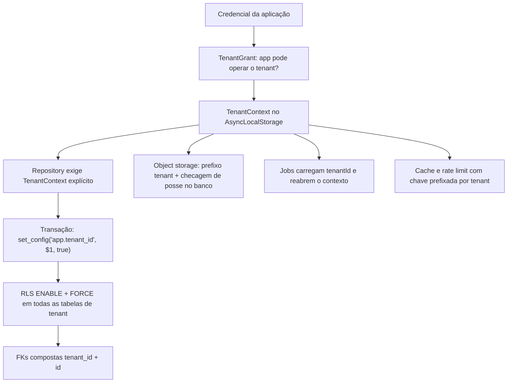

# 14 — Integridade fiscal e isolamento multi-tenant (aprofundamento)

# Parte A — Integridade fiscal

## A1. Escopo de validação (ADR-0018 revisado)
O motor **não decide** a política tributária (qual CST/CSOSN, alíquota ou benefício a empresa aplica). Mas **valida rigorosamente** tudo o que recebe:

| Camada | Onde | O que valida | Exemplo |
|---|---|---|---|
| L1 — Contrato | `presentation` (Zod) | tipos, formatos, tamanhos, campos obrigatórios do contrato da API | valor como string decimal, CNPJ com 14 posições |
| L2 — Invariantes | `domain` (Value Objects) | DV de CNPJ/CPF (numérico e alfanumérico), código IBGE existente, datas coerentes, escalas decimais | competência não pode ser futura (se a regra oficial disser) |
| L3 — Regras fiscais | `domain` (rule set versionado) | obrigatoriedade condicional, **regras matemáticas** (totais = soma dos itens, base × alíquota = valor dentro da tolerância oficial), compatibilidade entre campos, códigos pertencentes às tabelas oficiais | total do serviço ≠ soma → rejeitado localmente |
| L4 — Leiaute | `infrastructure` (XSD oficial) | XML gerado válido contra o schema oficial da versão gravada no documento | campo fora do padrão XSD |
| L5 — Pré-transmissão | `application` | certificado ativo e válido, ambiente coerente, série ativa, roteamento definido, tenant habilitado para produção | certificado vencido → `FAILED` antes do envio |
| L6 — Autorizador | autorizador oficial | **a única validação que dá validade fiscal** | autorização com protocolo |

Regras:
- Cada regra L3 tem **ID**, **fonte oficial** (manual/NT/seção; código de rejeição oficial quando ela espelha uma rejeição do autorizador), **vigência**, **teste** e documento em `docs/fiscal/regras/<id>.md`. Sem fonte, a regra não entra.
- Erros de validação retornam todos os problemas de uma vez, com `ruleId`, campo e mensagem.
- Validar localmente não significa estar conforme: só a autorização oficial (L6) confere validade.
- O especialista fiscal revisa o catálogo de regras ao fim do modelamento de cada modalidade (*gate* fiscal).

## A2. Imutabilidade
- Após a aceitação, dados fiscais do documento (payload, série, número, ambiente, roteamento, versões) são **imutáveis**. Garantido em duas camadas: no agregado e por **trigger** no PostgreSQL que bloqueia UPDATE dessas colunas.
- Transições de estado também são conferidas por trigger contra a matriz permitida (defesa em profundidade contra bug no código).
- Correções acontecem pelos instrumentos fiscais oficiais (cancelamento, substituição, CC-e), nunca editando o documento.

## A3. Integridade dos artefatos
- XML autorizado/retornado é guardado **exatamente como recebido** (bytes), com SHA-256 no banco.
- Assinatura do documento autorizado é verificada ao receber.
- Object Lock (retenção) no bucket de artefatos autorizados.
- Job semanal de verificação: recalcula hashes de uma amostra (e mensalmente de todos) e compara com o banco; divergência = incidente.

## A4. Trilha de auditoria à prova de adulteração
- `audit_log` append-only (sem UPDATE/DELETE por grant + trigger), com `hash = sha256(prev_hash ‖ registro)` por tenant.
- Diariamente, o hash da cabeça da cadeia de cada tenant é exportado para o bucket com Object Lock (âncora externa): adulterar o banco passa a ser detectável.

## A5. Ambientes
- `environment` é imutável por documento; séries e certificados de homologação e produção separados.
- Um tenant só emite em produção depois de flag `production_enabled` habilitada por operador (auditado).
- O processo **não inicia** em produção se algum gateway estiver configurado como simulador (`fake`).

## A6. Valores e tempo
- Valores com decimal de precisão arbitrária; arredondamento conforme regra oficial de cada campo, centralizado em um único módulo testado.
- Servidor com NTP monitorado; data/hora de emissão com fuso do emitente.

# Parte B — Isolamento multi-tenant

## B1. Camadas de isolamento



## B2. Banco de dados
- Papéis: `fiscal_owner` (migrations, dono das tabelas, não usado pela aplicação), `fiscal_api`, `fiscal_worker`, `fiscal_general`, `fiscal_system` (varreduras globais restritas). **Nenhum** com `BYPASSRLS`.
- `ALTER TABLE ... ENABLE ROW LEVEL SECURITY` **e** `FORCE ROW LEVEL SECURITY`.
- Política padrão (fail-closed):
  ```sql
  CREATE POLICY tenant_isolation ON service_invoices
    USING (tenant_id = nullif(current_setting('app.tenant_id', true), '')::uuid)
    WITH CHECK (tenant_id = nullif(current_setting('app.tenant_id', true), '')::uuid);
  ```
  Sem contexto definido → nenhuma linha visível, nenhuma escrita aceita.
- `set_config(..., true)` = vale só para a transação; conexões do pool não "herdam" tenant.
- `fiscal_system` (reconciliação/stuck-scan) só tem SELECT em uma **view** mínima (`id, tenant_id, status, next_check_at`) e, para processar cada item, abre uma transação **no contexto do tenant** do item.

## B3. Aplicação
- Tenant vem da credencial + concessão, nunca do payload; CNPJ do emitente é conferido contra os estabelecimentos do tenant.
- Recurso de outro tenant responde **404** (não 403), para não revelar existência.
- URLs pré-assinadas do S3 só são geradas após confirmar no banco (com RLS) que o artefato pertence ao tenant; prefixo `tenant/{tenantId}/` conferido pelo adapter.

## B4. Testes de isolamento (gate bloqueante no CI)
1. **Meta-teste de schema**: varre `information_schema`/`pg_class`; toda tabela com `tenant_id` precisa ter RLS habilitado **e forçado** e políticas com `USING` e `WITH CHECK`. Tabela sem `tenant_id` precisa estar em uma allowlist revisada. Uma tabela nova sem RLS quebra o build.
2. **Matriz de API gerada**: a partir do registro de rotas do Fastify, para **cada rota** de tenant: cria recursos como tenant A e tenta ler/alterar/cancelar/baixar com credencial do tenant B → 404 esperado. Rota nova entra automaticamente no teste.
3. **Repositories**: cada repository tem teste cruzado A/B gerado por helper comum.
4. **Vazamento de pool**: transação no tenant A, em seguida consulta sem contexto na mesma conexão → zero linhas.
5. **WITH CHECK**: INSERT/UPDATE com `tenant_id` diferente do contexto → erro.
6. **Jobs**: job adulterado com `tenantId` de A apontando para documento de B → não encontra o documento.
7. **CNPJ spoofing**: payload com CNPJ de estabelecimento de outro tenant → rejeitado.
8. **Concessão revogada**: revogar grant → próxima requisição negada (sem cache stale).
9. **Storage**: tentativa de baixar artefato de B com credencial de A → 404; chave fora do prefixo → erro no adapter.
10. **Teste baseado em propriedades**: operações aleatórias intercaladas entre 3 tenants; invariante "nenhum tenant vê/alterar dado de outro".
11. **Teste do teste**: em ambiente de teste, desativar uma política propositalmente e verificar que os testes 1 e 2 falham.
12. Testes rodam com os **mesmos papéis de banco** de produção (nunca como superusuário).
