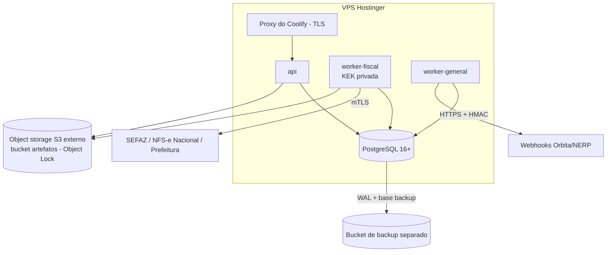

# 15 — Infraestrutura inicial (VPS Hostinger + Coolify)

## 1. Topologia

| Container | Réplicas iniciais | Exposição |
|---|---|---|
| `api` | 1 (2 quando necessário) | HTTPS público via proxy do Coolify |
| `worker-fiscal` | 1 | sem porta exposta |
| `worker-general` | 1 | sem porta exposta |
| `postgres` | 1 | **somente rede interna** |
| Redis | **não na Fase 1** | ver abaixo |

**Redis adiado**: com uma instância de API, rate limiting em memória basta e fila/locks estão no PostgreSQL. Redis entra quando houver mais de uma instância de API ou necessidade comprovada (ADR-0020).

## 2. Object storage — avaliação

| Opção | Prós | Contras | Veredito |
|---|---|---|---|
| MinIO self-hosted | conhecido | edição community arquivada/sem imagens oficiais desde 2025 ([fonte](https://glukhov.org/data-infrastructure/object-storage/minio-dead/), [fonte](https://linuxiac.com/minio-ends-active-development/)) | **descartado** |
| Garage / SeaweedFS / RustFS na mesma VPS | gratuito, S3-compatível | mesma máquina = sem cópia fora do servidor; suporte a Object Lock a verificar | só para **dev/teste local** |
| **Backblaze B2** | barato, S3-compatível, Object Lock ([referência](https://www.backblaze.com/cloud-storage/b2-reserve)) | regiões fora do Brasil (avaliar LGPD) | **recomendado** (confirmar Object Lock no plano pay-as-you-go) |
| Cloudflare R2 | sem custo de egress | bucket locks próprios, API S3 Object Lock não implementada ([fonte](https://hackceleration.com/labs/switch/cloudflare-r2)) | alternativa |
| AWS S3 (sa-east-1) | Object Lock maduro, região Brasil, KMS no mesmo provedor | custo maior | alternativa premium |
| Provedor nacional S3-compatível (ex.: Magalu Cloud) | dados no Brasil | Object Lock e maturidade a verificar | avaliar se LGPD exigir |

Recomendação: **Backblaze B2** (ou AWS S3 sa-east-1 se preferir dados no Brasil), com:
- bucket `artifacts` com versionamento + Object Lock e retenção mínima a confirmar com o contador (trabalho com ≥ 5 anos + margem);
- bucket `backups` separado, credenciais separadas;
- chaves de aplicação com permissão mínima (a `api` não precisa de delete; ninguém da aplicação tem permissão de alterar retenção).
- Dev/CI: SeaweedFS ou Garage em container (escolha no spike da Fase 1).
- Preços e recursos acima são de fontes secundárias: confirmar nas páginas oficiais antes da contratação.

LGPD: XMLs contêm dados pessoais (CPF, endereço). Armazenamento fora do Brasil é transferência internacional — avaliar base legal com o responsável jurídico antes de produção.

## 3. Backup e recuperação
- PostgreSQL: **WAL-G** (decidido na semana 7; imagem `docker/postgres`) com archive contínuo de WAL (`archive_timeout=60`) + base backup diário no bucket `backups`, cifrado no cliente com libsodium. **RPO alvo: ≤ 5 min. RTO alvo: ≤ 4 h** (VPS única). Runbook: [backup-restauracao](../runbooks/backup-restauracao.md).
- Teste de restauração **mensal** documentado em runbook: `npm run drill:backup` (exercício local completo; primeiro OK em 2026-11-11).
- Backup offline das KEKs (doc 13).
- VPS única é ponto único de falha: aceitável na fase inicial com RPO/RTO acima; reavaliar antes de muitas empresas.

## 4. Rede e acesso
- Firewall: somente 443 (e 22 restrito por IP/chave). PostgreSQL nunca exposto.
- Painel do Coolify restrito (IP/VPN) com 2FA.
- **TLS com SEFAZ/NFS-e**: servidores governamentais podem usar certificados ICP-Brasil que não estão no repositório padrão do Node. Usaremos bundle de ACs ICP-Brasil versionado (`resources/`) por endpoint; **nunca** `rejectUnauthorized: false`.
- NTP habilitado e monitorado.

## 5. Coolify
- Um "resource" por container, mesma imagem com `command` diferente (`node dist/main/api.js`, `.../worker.js --role=fiscal`, `--role=general`).
- Secrets por serviço (KEK privada só no `worker-fiscal`, como arquivo).
- Deploy por imagem gerada no GitHub Actions (tag por commit), não build na VPS.
- Migrations executadas como job de deploy com o papel `fiscal_owner`, antes de subir a nova versão.

## 6. Observabilidade na VPS
- Logs JSON coletados pelo Coolify; métricas Prometheus expostas internamente.
- Inicial: Uptime Kuma (health) + alertas por e-mail/Telegram; Grafana/Prometheus próprio na Fase 5.
- Nenhum dado pessoal ou fiscal enviado para serviços externos de observabilidade.
