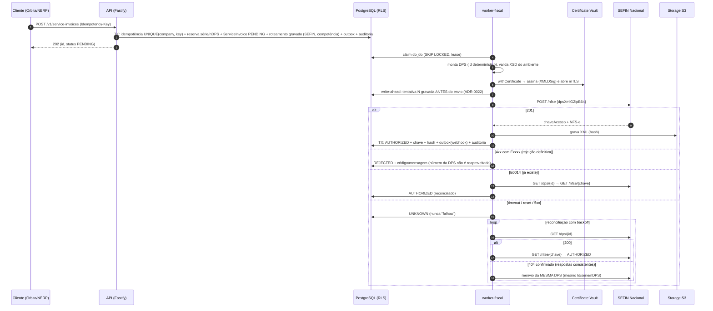

# Diagnóstico — APIs de NFS-e em Teresina × Sistema Nacional NFS-e

> Consultas feitas em **2026-11-10**, versão 2 do diagnóstico. A versão 2 incorpora a página da Carta de Serviços da SEMF e o **Guia de Utilização da API THE V7**.
> Nenhuma emissão foi feita e nenhuma credencial foi usada. Também não houve envio de dados fiscais: só leitura de páginas, downloads públicos e requisições GET ou HEAD sem credencial, para ver o comportamento dos servidores.
> **Status: aguardando aprovação do responsável. Nada foi implementado.**

Classificação:
- **CONFIRMADO**: há evidência documental oficial (Prefeitura/SEMF, DOM, gov.br/nfse, RFB) ou comportamento observado diretamente no servidor.
- **PROVÁVEL**: a evidência é indireta e falta confirmação.
- **NÃO CONFIRMADO**: não há evidência suficiente.

Documentos de terceiros nunca contam como prova.

---

## Resumo executivo (respostas objetivas)

| Pergunta | Resposta | Classificação |
|---|---|---|
| A empresa-piloto (ME/EPP do Simples, Teresina) pode usar a API municipal para **novas** emissões (competência ≥ 01/11/2026)? | **Não.** A Prefeitura deve bloquear, e o ADN rejeita a nota se o município tentar compartilhá-la | CONFIRMADO (Res. CGSN 191/2026; notícia do Portal NFS-e de 29/10/2026) |
| Deve usar obrigatoriamente a SEFIN Nacional? | **Sim**, o Emissor Nacional (web ou API). Para integração de sistema, isso significa a API da SEFIN Nacional | CONFIRMADO |
| O novo emissor municipal é uma interface sobre a infraestrutura nacional? | **Não.** É infraestrutura própria da Prefeitura, operada pela DSF, que adota o **leiaute e o contrato de API do padrão nacional** e **compartilha** as notas com o ADN | CONFIRMADO (Guia API THE V7; Carta de Serviços; manual nacional: "Sefins municipais que desejarem seguir o padrão nacional") |
| Precisa de credenciamento específico? | Municipal: **não**, "bastando que a empresa esteja apta a emitir NFS-e" em Teresina. Nacional: não há credenciamento de software documentado; as validações são cadastrais (CNPJ, Simples, CNC) e de certificado | Municipal CONFIRMADO (Carta de Serviços). Nacional: PROVÁVEL |
| E a competência anterior a 11/2026? | Continua no **emissor municipal**, que deve mantê-la autorizada. O Emissor Nacional **barra** retroativas destinadas a município com emissor próprio. O cancelamento e a substituição ocorrem no sistema que gerou a nota | Emissão: CONFIRMADO (notícia de 29/10/2026). Eventos: PROVÁVEL (Anexo II), **confirmar com a SEMF** |
| E a partir de 01/01/2027? | O grupo `IBSCBS` da DPS passa a ser **obrigatório para optantes do Simples**. As regras específicas do Simples na NT 009 (`regApIBSCBSSN`, `cAtvSN`, `gTribSN`, `opSimpNac=4`) **ainda não estão em nenhum XSD publicado**. A substância tributária (CST, cClassTrib, regime) é decisão do contribuinte e do contador | Obrigatoriedade: CONFIRMADO (Anexo I, linha 335). Leiaute final: NÃO CONFIRMADO |
| Os hosts `nfseapi.teresina.pi.gov.br` e `nfse2-the.dsfweb.com.br` são da API antiga (RPS)? | **Não.** São os hosts da **nova** API DPS, publicados no Guia V7 de 20/08/2026 e na Carta de Serviços. A API antiga do ISS Digital (`issdigitalthe.com.br`) foi desativada | CONFIRMADO (novos). Antiga desativada: PROVÁVEL (ver §2) |

**Recomendação:** para a primeira NFS-e da empresa-piloto, usar **somente a API da SEFIN Nacional**. Detalhes em §9.

---

## 1. API municipal atual de Teresina (DPS, "Modelo Nacional com RTC")

### 1.1 Documentos publicados
| Documento | Onde | Versão / data | SHA-256 | Classif. |
|---|---|---|---|---|
| Carta de Serviços SEMF — "Nota Fiscal de Serviços - Padrão Nacional" | `https://cartadeservicos-semf.pmt.pi.gov.br/dps` | "Última atualização: 20/08/2026, 11:46" | — (página dinâmica) | CONFIRMADO |
| **Manual de Contribuintes — Guia de Utilização da API THE — V7** (DSF) | Google Drive linkado pela Carta: `https://drive.google.com/file/d/1ftBz1sfh7WQdUSSBcFU1WL7Gv0r9FdVy/view` | V7, PDF criado em 20/08/2026 | `5a75fca07c0779a4c9d14100ea84bb12f1ce4120b125455f876a27caca5742ff` | CONFIRMADO |
| Manual de Contribuintes — Guia do Emissor Municipal Web da NFS-e — V1 (DSF) | `https://drive.google.com/file/d/1YsKOBytqUPWUsQTOTHj4gT4jD3I33GPf/view` | V1, PDF criado em 01/07/2026 | `ec0957c4529ce1a3f0986c2e62c2ff96c619071f446988c23e9805ed02c510f8` | CONFIRMADO |
| XML modelo de DPS (`XML modelo_DPS.xml`) | `https://drive.google.com/file/d/1m1lrzLK6llBpe-EJf6t9I9P_3t_NOGVU/view` | sem versão (`dCompet` 2026-06-30) | `20b615b79436ae1d433aec4a67fd32948653db3075ed33c29003b6ff5d3c958d` | CONFIRMADO |
| Portal NFS-e, aba "Documentação da API" (CMS `POST /notafiscal-ws/servico/gestao-conteudo/`) | `https://notafiscal.teresina.pi.gov.br/notafiscal/paginas/portal/#/api` | consulta em 10/11/2026 | — | CONFIRMADO |
| XSD nacional v1.01 (linkado pelo portal e pela Carta) | `https://www.gov.br/nfse/pt-br/biblioteca/documentacao-tecnica/documentacao-atual/nfse-esquemas_xsd-v1-01-20260209.zip` | v1.01, 09/02/2026 | `e7935cbd9470527c6cc32984c1b2263e614183bf0139ce2733eaaed2de9a8072` | CONFIRMADO |
| Anexo I nacional v1.01 (o "manual de integração" da Carta) | `…/documentacao-atual/anexo_i-sefin_adn-dps_nfse-snnfse-v1-01-20260209.xlsx` | v1.01, 09/02/2026 | `de5bc492959eadc8bfa7540e16939995924f2188f743648eaf84d3b31e9eeb7c` | CONFIRMADO |

Não há Swagger ou OpenAPI publicado: as tentativas de `swagger-ui.html` e `v3/api-docs` respondem 404. A única especificação é o Guia V7.

### 1.2 Ambientes [CONFIRMADO: Guia V7 §5, Carta de Serviços e CMS do portal]
| Ambiente | URL base | `tipoAmbiente` na resposta |
|---|---|---|
| Produção | `https://nfseapi.teresina.pi.gov.br` | `1` (observado) |
| Homologação | `https://nfse2-the.dsfweb.com.br` (hospedado pela DSF) | `2` (observado) |
| Homologação, sistema web | `https://nfse2-the.dsfweb.com.br/notafiscal/` | — |

A Carta de Serviços lista ainda um "Web service (endpoint ADN/DPS)" em `https://nfse2-the.dsfweb.com.br/notafiscal-adn-ws/api/adn/dps`. Esse caminho **redireciona com 302** para `/notafiscal-ws/api/adn/dps`, e o equivalente em produção responde 404. **O Guia V7 não menciona esse caminho.** Classificação: NÃO CONFIRMADO, pergunta para a SEMF (§10).

### 1.3 Endpoints [CONFIRMADO: Guia V7]
| # | Método | Caminho | Corpo da requisição (JSON) | Respostas documentadas |
|---|---|---|---|---|
| 1 | POST | `/notafiscal-ws/nfse` | `{"dpsXmlGZipB64": "<DPS gzip+base64>"}` | **201** `{tipoAmbiente, versaoAplicativo, dataHoraProcessamento, idDps, chaveAcesso, nfseXmlGZipB64, alertas[]}`; **400** "Não foi possível criar a NFS-e"; **403** "Certificado digital da transmissão inválido ou fora dos padrões da NFS-e"; **500** "Falha durante o processamento do DPS" |
| 2 | POST | `/notafiscal-ws/nfse/{chaveAcesso}/eventos` (chave de 50 posições) | `{"pedidoRegistroEventoXmlGZipB64": "<pedRegEvento gzip+base64>"}` | **201** `{tipoAmbiente, versaoAplicativo, dataHoraProcessamento, eventoXmlGZipB64}`; **400** viola regra de negócio; **401** "Usuário não tem permissão para acessar os eventos" |
| 3 | GET | `/notafiscal-ws/nfse/{chaveAcesso}` | — | **200** `{tipoAmbiente, versaoAplicativo, dataHoraProcessamento, chaveAcesso, nfseXmlGZipB64}`; **400** chave precisa ter 50 números; **401** "Não foi possível obter o certificado de cliente"; **403** consulta não permitida; **404** chave não encontrada |
| 4 | GET | `/notafiscal-ws/nfse/dps/{id}` | — | **200** `{tipoAmbiente, versaoAplicativo, dataHoraProcessamento, idDps, chaveAcesso}`; **400** Id de DPS inválido; **404** "Não foi gerada uma NFS-e com o identificador de DPS informado" |

Observações:
- **Emissão individual:** só síncrona e individual, uma DPS por POST [CONFIRMADO].
- **Lote:** a Carta descreve a "funcionalidade de lote" do portal, que historicamente recebia RPS e agora recebe DPS. **Não há endpoint de lote na API documentada** [NÃO CONFIRMADO para API].
- **Substituição:** é uma DPS com a chave a substituir. O sistema gera o evento "Cancelamento de NFS-e por Substituição" vinculado à original e devolve a NFS-e substituta [CONFIRMADO, Guia V7 §3.1].
- **Cancelamento:** feito via endpoint #2, o evento "por exemplo, cancelamento" [CONFIRMADO]. Os tipos aceitos não estão listados no Guia; pelo leiaute nacional, o cancelamento é o `e101101` [PROVÁVEL].
- **Ausentes:** `HEAD /dps/{id}`, GET de eventos, parâmetros municipais, DANFSe e PDF.
- **Corpo do erro 400:** não detalhado no Guia. A sondagem sem credencial devolveu `{"tipoAmbiente","versaoAplicativo":"1.01","dataHoraProcessamento","erros":[{}]}` [observado]. Pelo uso do Anexo I nacional, os códigos de rejeição seriam os `Exxxx` nacionais [PROVÁVEL].

### 1.4 Autenticação, certificado e assinatura [CONFIRMADO: Guia V7 §2 e §4]
- **Autenticação:** "certificado cujo CNPJ tenha o **mesmo CNPJ Raiz** do contribuinte" da DPS. A resposta 401 "Não foi possível obter o certificado de cliente" indica **certificado de cliente TLS (mTLS)**.
  - O servidor não pede certificado no handshake inicial [observado]. Logo, a solicitação é feita **por renegociação na rota** [PROVÁVEL].
  - Não há API key, token, JWT nem OAuth.
- **Assinatura da DPS** (XMLDSig enveloped):
  - `<Signature xmlns="http://www.w3.org/2000/09/xmldsig#">` sem prefixo, irmã de `infDPS`;
  - `Reference URI="#<Id do infDPS>"`;
  - Transforms: `enveloped-signature` + `REC-xml-c14n-20010315`;
  - CanonicalizationMethod: C14N 2001-03-15;
  - **SignatureMethod `rsa-sha1`** e **DigestMethod `sha1`**.

### 1.5 Formato, XSD e DPS [CONFIRMADO]
- O envelope é **JSON**, e o documento é **XML compactado com gzip e codificado em Base64**.
- XSD: o nacional **v1.01 (09/02/2026)**, raiz `DPS versao="1.01"`. A estrutura está em §3.5.
- Particularidades municipais:
  - **`cTribMun` é obrigatório** (orientação do portal), obtido na tabela cTribNac × CNAE em `…/portal/#/tabela`;
  - o caminho de consulta pela DPS é `/nfse/dps/{id}`, e não `/dps/{id}`.

### 1.6 Exemplo documentado [CONFIRMADO: Guia V7 e XML modelo]
- **Requisição** (Guia V7): `POST https://nfse2-the.dsfweb.com.br/notafiscal-ws/nfse` com `{"dpsXmlGZipB64": "string"}`.
- **Resposta 201** (Guia V7): `{"tipoAmbiente": 1, "versaoAplicativo": "string", "dataHoraProcessamento": "2026-07-02T11:21:04.4340416-03:00", "idDps": "string", "chaveAcesso": "string", "nfseXmlGZipB64": "string", "alertas": [ … ]}`.
- **XML modelo da SEMF**: valores anonimizados com `?`, não assinado, com estes campos:
  - `serie` 00001, `nDPS` 1, `prest/regTrib/opSimpNac=1`, `regEspTrib=0`;
  - `cTribNac` 010301, `cTribMun` 001, `cNBS` 115069000;
  - `tribISSQN=1`, `tpRetISSQN=1`, `pAliq=5`;
  - `tribFed/piscofins` com CST 00;
  - `IBSCBS` com `finNFSe=0`, `cIndOp=100301`, `cClassTrib=000001`.
  - É **ilustrativo**, de um prestador **não optante**. **Não serve de referência tributária** para a empresa-piloto.

### 1.7 Credenciamento [CONFIRMADO: Carta de Serviços]
"Para a transmissão de DPS os contribuintes não precisam de um credenciamento prévio, bastando apenas que a empresa esteja apta a emitir nota fiscal de serviços no município de Teresina."

---

## 2. API municipal antiga (RPS / ISS Digital)

| Pergunta | Resposta | Classif. |
|---|---|---|
| `nfseapi.teresina.pi.gov.br/notafiscal-ws` e `nfse2-the.dsfweb.com.br/notafiscal-ws` são a API antiga? | **Não.** São os hosts da **nova** API DPS: o Guia V7 (20/08/2026, "Modelo Nacional com RTC") e a Carta os listam como endpoints DPS. A afirmação do terceiro está **desatualizada ou incorreta** | CONFIRMADO |
| Onde ficava o emissor antigo? | `www.issdigitalthe.com.br/nfse`, referenciado na Carta, hoje **redireciona com 302** para o novo portal `notafiscal.teresina.pi.gov.br` | CONFIRMADO (observado) |
| O webservice antigo está ativo? | O caminho SOAP típico do ISS Digital da DSF, `https://www.issdigitalthe.com.br/WsNFe2/LoteRps.jws?wsdl`, responde **410 Gone**, que indica remoção intencional. O caminho foi testado por conhecimento do padrão do produto, **não por documento oficial** | PROVÁVEL |
| Foi substituído pela DPS? | Sim. A Carta diz que o lote "historicamente era utilizado para transmitir RPS" e que "no modelo nacional ganha relevância o conceito de DPS, que substitui o papel operacional do RPS" | CONFIRMADO |
| Algum grupo ainda usa RPS? | Não há evidência | NÃO CONFIRMADO |
| Documentação própria da API antiga? | Não encontrada em canais oficiais atuais | NÃO CONFIRMADO |
| Associação ao provedor "IMA" | Não há evidência oficial. Os sistemas observados (antigo e novo) são da DSF | NÃO CONFIRMADO |
| Compatível com o padrão nacional? | A antiga (RPS) não. A nova segue o padrão nacional (DPS, XSD e Anexo I nacionais) | CONFIRMADO para a nova |

---

## 3. SEFIN Nacional (emissor público nacional)

### 3.1 SEFIN × ADN [CONFIRMADO: página de APIs do gov.br/nfse, atualizada em 20/08/2026]
- **SEFIN Nacional** = **autorizador**: recebe a DPS, valida, gera a NFS-e e registra eventos.
  - Produção: `https://sefin.nfse.gov.br/SefinNacional/docs/index`
  - Produção restrita: `https://sefin.producaorestrita.nfse.gov.br/API/SefinNacional/docs/index`
- **ADN** = **repositório e distribuição**: recebe a NFS-e de todos os autorizadores, inclusive o sistema da DSF em Teresina, e distribui DF-e por NSU. Também hospeda parametrização municipal, CNC e o DANFSe, este suspenso em 03/08/2026.
  - Hosts: `adn.nfse.gov.br` e `adn.producaorestrita.nfse.gov.br`.
  - **O motor não emite pelo ADN.**

O Swagger da SEFIN responde **403 sem certificado de cliente** [observado]. A leitura fica para depois, com o A1 real.

### 3.2 Endpoints [CONFIRMADO: Manual de Contribuintes — Emissor Público API, "v1.2 out/2025"]
| Método | Caminho | Finalidade |
|---|---|---|
| POST | `/nfse` | DPS → NFS-e síncrona. Com `subst/chSubstda`, gera automaticamente o cancelamento por substituição da original |
| GET | `/nfse/{chaveAcesso}` | Consulta a NFS-e |
| GET | `/dps/{id}` | Chave de acesso pelo Id da DPS. **Só responde se o certificado da conexão for de um ator da nota** |
| HEAD | `/dps/{id}` | Informa se existe NFS-e para a DPS. Responde a qualquer certificado válido |
| POST | `/nfse/{chaveAcesso}/eventos` | Registro de evento. "As mensagens de comunicação com a API utilizarão o padrão JSON […] o DF-e utiliza o padrão XML contendo a assinatura digital" |
| GET | `/nfse/{chaveAcesso}/eventos[/{tipoEvento}[/{numSeqEvento}]]` | Consulta de eventos |
| GET | `/parametros_municipais/{codMun}/convenio`, `/{codMun}/{codServico}`, `/{codMun}/{CPF/CNPJ}` | Parâmetros municipais. A combinação de host (SEFIN ou ADN `/parametrizacao`) e caminho é PROVÁVEL |

- **Prefixo de caminho** (`/SefinNacional` ou `/API/SefinNacional`): NÃO CONFIRMADO. Será fechado no Swagger.
- **Envelope `dpsXmlGZipB64`:** PROVÁVEL para a SEFIN. As regras nacionais E1225 (Base64) e E1226 (descompactação) confirmam o gzip+Base64, e o Guia DSF, que replica o padrão nacional, usa exatamente esse nome. Falta a confirmação no Swagger.

### 3.3 Autenticação e certificados [CONFIRMADO: Anexo I, RN_RECEPCAO_DPS]
- **Certificado da conexão** (E1200–E1209): X.509 v3 ICP-Brasil, que não seja de AC, com KeyUsage "Autenticação Cliente", validade, cadeia, LCR e CNPJ/CPF no OtherName.
- **Assinatura:** E0714–E0718. É obrigatória via Web Service, feita com o certificado **do emitente**, com KeyUsage "Assinatura Digital" e "Não Recusa".
- **Algoritmos da assinatura nacional:** nenhum documento nacional os especifica. O Guia DSF, que gera DPS compartilhadas e validadas pelo ADN, usa **RSA-SHA1, SHA-1 e C14N**, o que indica que é o mesmo padrão nacional [PROVÁVEL]. Confirmar em produção restrita.

### 3.4 Recuperação de operações [CONFIRMADO]
- **E0014** (Anexo I): "Conjunto de Série, Número, Código do Município Emissor e CNPJ/CPF informado nesta DPS já existe em uma NFS-e gerada a partir de uma DPS enviada anteriormente".
  - A SEFIN, portanto, **impõe unicidade por série+número+município+CNPJ**. Reenviar a mesma DPS nunca gera duas notas.
- Reconciliação: `GET /dps/{id}` (prestador é ator) → `GET /nfse/{chave}`. `HEAD /dps/{id}` só diz se existe.

### 3.5 XSD e DPS [CONFIRMADO]
Pacotes: produção v1.01 (09/02/2026) e **produção restrita 20/10/2026**, que traz CNPJ alfanumérico, `finNFSe` em `infDPS` e `vAjusteBC`. **Os dois ambientes estão hoje em leiautes diferentes.**

Campos da DPS:
- `infDPS@Id`: "DPS" + cMun(7) + tpInsc(1) + inscrição(14) + série(5) + nDPS(15).
- Cabeçalho: `tpAmb`, `dhEmi`, `verAplic`, `serie`, `nDPS`, `dCompet`, `tpEmit`, `cLocEmi`, `subst`.
- **`prest/regTrib`**:
  - `opSimpNac`: 1 Não optante, 2 MEI, 3 ME/EPP;
  - `regApTribSN`: 1 a 3, obrigatório para ME/EPP pela E0166;
  - `regEspTrib`.
- `toma` e `interm`: CNPJ, CPF, NIF ou cNaoNIF.
- `serv/cServ`: `cTribNac` (6), `cTribMun` (3, 0..1), `xDescServ`, `cNBS`.
- `valores/trib`:
  - `tribMun`: `tribISSQN`, `tpRetISSQN`, `pAliq`;
  - `tribFed`;
  - `totTrib`: ME/EPP não pode usar `indTotTrib` (E0712).
- `IBSCBS` (0..1).
- Chave da NFS-e: 50 dígitos.

### 3.6 Eventos e cancelamento [CONFIRMADO: XSD tiposEventos v1.01 e Anexo II v1.01]
- `e101101`, cancelamento: `cMotivo` 1, 2 ou 9, com `xMotivo` obrigatório.
- `e105102`, cancelamento por substituição: gerado pela SEFIN.
- E0061: na substituta de ME/EPP, não se altera o tomador, o `dCompet` nem o `vServ`.
- E0050: o prazo segue a parametrização do município.
- **Prazo do `e101101`:** NÃO CONFIRMADO (aba de regras do Anexo II).

### 3.7 Situação de Teresina no Sistema Nacional [CONFIRMADO: planilha de municípios aderentes de 28/09/2026]
- "Conveniado Ativo", aderente ao **ADN**, **não aderente ao Emissor Nacional**.
- A regra **E0039** do Anexo I de produção restrita (20/10/2026) abre exceção para ME/EPP com `regApTribSN=1` e `dCompet ≥ 01/11/2026`.
- **Ressalvas:**
  1. O Anexo I de **produção** (09/02/2026) ainda traz a E0039 sem essa exceção. A ativação em produção é PROVÁVEL (a notícia de 29/10 diz "todos os optantes estarão habilitados") e falta confirmar.
  2. ME/EPP com `regApTribSN` 2 ou 3 fica fora da exceção textual. **O contador precisa confirmar o enquadramento da empresa-piloto.**

---

## 4. Tabela comparativa

| Aspecto | Municipal atual (DSF, DPS) | Municipal antiga (ISS Digital, RPS) | SEFIN Nacional |
|---|---|---|---|
| Situação | Ativa | Portal redireciona; WS com 410 (PROVÁVEL) | Ativa |
| Empresa-piloto, competência ≥ 11/2026 | **Proibida** (bloqueio obrigatório) | — | **Obrigatória** |
| Empresa-piloto, competência < 11/2026 | Permitida (único canal) | — | Barra retroativas para município com emissor próprio |
| Documento | DPS v1.01 nacional | RPS (padrão DSF) | DPS v1.01 (produção restrita: 20/10/2026) |
| Envelope | JSON + XML gzip+Base64 | SOAP (PROVÁVEL) | JSON + XML gzip+Base64 (PROVÁVEL quanto ao nome do campo) |
| Autenticação | Certificado de cliente, mesmo CNPJ raiz | — | Certificado de cliente ICP-Brasil (E1200–E1209) |
| Assinatura | XMLDSig enveloped, C14N, RSA-SHA1 (documentado) | — | XMLDSig com o certificado do emitente. Algoritmos: PROVÁVEL igual |
| Emitir | `POST /notafiscal-ws/nfse` | — | `POST /nfse` |
| Consultar pela chave | `GET /notafiscal-ws/nfse/{chave}` | — | `GET /nfse/{chave}` |
| Chave pela DPS | `GET /notafiscal-ws/nfse/dps/{id}` | — | `GET /dps/{id}` + `HEAD /dps/{id}` |
| Eventos | `POST …/nfse/{chave}/eventos` | — | `POST` + `GET` de eventos |
| Substituição | DPS com chave substituída | — | DPS com `subst/chSubstda` |
| Parâmetros municipais | Não há | — | Há (autenticado) |
| Lote | Só no portal web (não na API) | Sim (RPS) | Não |
| Homologação | `nfse2-the.dsfweb.com.br` | — | Produção restrita oficial |
| Especificação | Guia V7 (8 páginas) + XSD e Anexo I nacionais | — | Manual + Anexos I e II + XSD + Swagger (com certificado) |

---

## 5. Links diretos

Teresina:
- Carta de Serviços: `https://cartadeservicos-semf.pmt.pi.gov.br/dps`
- Guia API V7: `https://drive.google.com/file/d/1ftBz1sfh7WQdUSSBcFU1WL7Gv0r9FdVy/view`
- Guia Emissor Web V1: `https://drive.google.com/file/d/1YsKOBytqUPWUsQTOTHj4gT4jD3I33GPf/view`
- XML modelo: `https://drive.google.com/file/d/1m1lrzLK6llBpe-EJf6t9I9P_3t_NOGVU/view`
- Portal da API: `https://notafiscal.teresina.pi.gov.br/notafiscal/paginas/portal/#/api`
- Portaria SEMF 20/2026: `https://dom.pmt.pi.gov.br/admin/upload/DOM4182-22012026-ASSINADO.pdf`
- Portaria SEMF 25/2026: `https://dom.pmt.pi.gov.br/admin/upload/DOM4191-04022026-ASSINADO.pdf`

Nacional:
- Documentação atual: `https://www.gov.br/nfse/pt-br/biblioteca/documentacao-tecnica/documentacao-atual/documentacao-atual`
- Produção restrita: `https://www.gov.br/nfse/pt-br/biblioteca/documentacao-tecnica/producao-restrita`
- RTC: `https://www.gov.br/nfse/pt-br/biblioteca/documentacao-tecnica/rtc`
- APIs: `https://www.gov.br/nfse/pt-br/biblioteca/documentacao-tecnica/apis-prod-restrita-e-producao`
- Municípios aderentes: `https://www.gov.br/nfse/pt-br/municipios/monitoramento-adesoes/municipios-aderentes-20260928.xlsx`
- Notícia de 29/10/2026: `https://www.gov.br/nfse/pt-br/noticias/nfs-e-informa-diretrizes-sobre-a-obrigatoriedade-da-emissao-da-nfs-e-nacional-para-optantes-do-simples-nacional`
- Res. CGSN 191/2026: `https://normas.receita.fazenda.gov.br/sijut2consulta/link.action?idAto=152781`

## 6. Versões, datas e hashes

| Documento | Versão / data | SHA-256 |
|---|---|---|
| Guia API THE (DSF/SEMF) | V7, 20/08/2026 | `5a75fca0…42ff` |
| Guia Emissor Municipal Web | V1, 01/07/2026 | `ec0957c4…10f8` |
| XML modelo DPS | — | `20b615b7…958d` |
| Portaria SEMF 20/2026 (DOM 4.182) | 22/01/2026 | `2cbaa636…66a7` |
| Portaria SEMF 25/2026 (DOM 4.191) | 04/02/2026 | `9b98e888…026a` |
| XSD nacional (produção) | v1.01, 09/02/2026 | `e7935cbd…8072` |
| XSD de produção restrita | 20/10/2026 | `25fdcecc651a67a216496ab10d7566631e6ed10f721e37d62c7845dadb0ea267` |
| Anexo I (produção) | v1.01, 09/02/2026 | `de5bc492…eb7c` |
| Anexo I (produção restrita) | 20/10/2026 | `72b05981c8882cdd807f3acf901b669465360f9cf1b9d9e235ac4363dacfb2d8` |
| Anexo II (eventos) | v1.01, 22/01/2026 | `5abe83d7e51023ffa979cc466c628399f3e4bbf03c293b5b1a0817e873eb428e` |
| Manual Contribuintes — Emissor Público API | "v1.2 out/2025" | `ac2f36e34ff565cc36d67c5d67415c33cc09f27b2dea006e8da9bcd2ddce5581` |
| Manual Contribuintes — APIs ADN | v1.0, 12/02/2026 | `9ffc97d8b1be4c80a440b3569b0027df61265b9e75ef69437f21f9481a9a1d6d` |
| NT 004 / 007 / 008 / 009 | 10/12/2025 · 07/02/2026 · v1.02 14/07/2026 · v1.01 11/09/2026 | `707524b2…` · `24e46b39…` · `1265f403…` · `cc86c940…` |
| Municípios aderentes | 28/09/2026 | `53620c40387aefcc4ff48c26667dca16513550a1f036999b0208a51066ea912a` |
| Res. CGSN 191/2026 | 04/08/2026 (DOU 10/08/2026), efeitos a partir de 01/11/2026 | — |

Os arquivos estão no scratchpad da sessão. Na implementação, serão copiados para `resources/fiscal/schemas` e `docs/fiscal`, com os hashes recalculados.

## 7. Exemplos documentados de requisição e resposta
- **Teresina:** os quatro endpoints em §1.3 e o XML modelo em §1.6, todos do Guia V7 e da SEMF.
- **SEFIN Nacional:** os manuais não trazem exemplo JSON. O Swagger, que tem os exemplos, exige certificado. A conferência fica pendente e será feita com o A1 real (§10).

---

## 8. Fluxo de emissão recomendado (empresa-piloto)

---

## 9. Decisão arquitetural recomendada

1. **Implementar somente a SEFIN Nacional?** **Sim.** É o único canal legal para a empresa-piloto e cobre MEI e ME/EPP do Simples em qualquer município. Tem documentação oficial e produção restrita.
2. **Criar um adapter específico para Teresina?** **Não agora.** Hoje não há caso de uso, e o piloto não pode usá-lo para notas novas.
   - O adapter passa a fazer sentido em dois casos: (a) cliente de Teresina fora do Simples ME/EPP; (b) necessidade de automatizar eventos em notas com competência anterior a 11/2026.
   - Quando vier, será um adapter separado, com o mesmo `NfseGateway`.
   - Diferenças em relação ao nacional:
     - URL base e prefixo `/notafiscal-ws`;
     - caminho `/nfse/dps/{id}`;
     - ausência de `HEAD`;
     - certificado de mesmo CNPJ raiz;
     - `cTribMun` obrigatório;
     - erros 401 e 403 próprios.
3. **Preparar contratos para vários provedores?** **Só a porta que já existe.**
   - O `NfseGateway` tem estas operações: `submit(dps)`, `findKeyByDpsId(id)`, `fetch(chave)` e `registerEvent(chave, pedido)`.
   - O resultado é uma união fechada: `Authorized | Rejected(code, message) | AlreadyExists | Indeterminate`.
   - Nada de framework genérico de provedores, plugin loader ou DSL.
   - Como o contrato DSF espelha o nacional, a peça reaproveitável é o **cliente do "padrão nacional"**: serialização, gzip+Base64, assinatura e parse do JSON. Ele é parametrizado por um **perfil de endpoint** (URLs por ambiente, caminhos, capacidades como `supportsHead`). Isso é configuração, não abstração genérica.
4. **Compartilhar domínio sem misturar regras:**
   - `nfse/domain`: agregado `ServiceInvoice`, máquina de estados com `UNKNOWN`, `DpsId`, `ChaveAcesso`, value objects da DPS, validações de consistência e matemática **do leiaute nacional** (comuns aos dois canais) e regra de **roteamento por competência** (dado versionado com fonte).
   - `nfse/application`: casos de uso `IssueServiceInvoice`, `ProcessSubmission`, `ReconcileSubmission`, `CancelServiceInvoice` e `SubstituteServiceInvoice`, que dependem só da porta.
   - `nfse/infrastructure/gateways/national`: cliente do padrão nacional + perfil SEFIN.
   - `municipal/teresina-dsf` (futuro): perfil DSF + validações locais.
   - `fake`: simulador com modos de falha.
   - **Regra:** validação que só existe num canal (como `cTribMun` obrigatório em Teresina) fica no adapter, nunca no domínio.
   - O domínio **não escolhe** `opSimpNac`, `regApTribSN`, `cTribNac`, `pAliq`, retenções nem CST/cClassTrib. Esses valores vêm do cliente ou do cadastro aprovado pelo contador (ADR-0018).
5. **Versionar schemas e leiautes:**
   - `resources/fiscal/schemas/nfse-nacional/<versao>-<data>/`, com manifesto (URL, data, SHA-256, ambientes em que vale e vigência).
   - Seleção **por ambiente e por data**: produção usa 1.01-20260209 e produção restrita usa 20261020. A seleção é dado, não `if` (ADR-0013).
   - Cada `ServiceInvoice` grava a versão de leiaute e de regra com que foi validada.
   - Teste que recalcula os hashes no CI.

## 9.1 Reavaliação antifalhas

| Tema | Decisão |
|---|---|
| Idempotência | Duas camadas: (1) `UNIQUE(company, idempotency_key)` com hash do payload (ADR-0007); (2) `UNIQUE(company, establishment, série, nDPS)`. Na SEFIN, a **E0014** é a terceira barreira, do lado do autorizador |
| Numeração | Reserva atômica de `nDPS` na mesma transação da aceitação. Um número enviado **nunca** é reaproveitado, nem após rejeição. A série não usa a faixa 80000–89999 (reservada pelo Emissor Web) |
| Timeout | O resultado é `UNKNOWN`. O job **não** é marcado como falho e **não** reenvia às cegas |
| Estado `UNKNOWN` | Só sai por evidência: `GET /dps/{id}` 200 leva a AUTHORIZED; E0014 leva à reconciliação; 404 repetido e consistente, após uma janela mínima, permite reenviar **a mesma DPS** com o mesmo Id |
| Consulta de DPS após falha | `GET /dps/{id}` funciona porque o prestador é ator. `HEAD` serve de verificação barata. A DPS já assinada fica guardada e é reenviada idêntica, sem nova montagem |
| Recuperação de jobs | Lease com expiração. O job órfão volta para a fila, e o write-ahead (ADR-0022) diz se houve tentativa. Se houve, entra direto em reconciliação |
| Duplicidade | Repetir a requisição do cliente devolve o mesmo recurso. Repetir no worker é seguro por Id determinístico + E0014. Concorrência é tratada com `FOR UPDATE` / `SKIP LOCKED` |
| XML | DPS assinada e NFS-e autorizada no S3, com SHA-256 gravado no banco. Retenção conforme ADR-0010 (S3/LGPD ainda é decisão pendente do responsável) |
| Auditoria | Envio, rejeição, `UNKNOWN`, reconciliação e eventos entram na trilha encadeada da empresa (já implementada), sem o XML nem dados sensíveis |
| Assinatura | XMLDSig enveloped com C14N. Algoritmo RSA-SHA1 (documentado pela DSF, PROVÁVEL na SEFIN), parametrizado por perfil e **confirmado em produção restrita antes de fixar** |
| Certificados | Envelope e KEK já implementados. Falta: (a) conferir o KeyUsage "Autenticação Cliente" (E1200) e "Não Recusa" (E0716) na CERT-001; (b) consulta de LCR (dívida); (c) cache curto em `withCertificate`; (d) comando de re-embrulho para rotação da KEK. A chave privada nunca sai do worker-fiscal |

---

## 10. Dúvidas para a SEMF (e para a DSF, por intermédio dela)

1. Confirmar por escrito que, desde 01/11/2026, a ME/EPP do Simples **não** emite mais no sistema municipal (competência ≥ 11/2026). Pedir também a posição da SEMF sobre o art. 1º da Portaria 20/2026 ("obrigatório e exclusivo") diante da Res. CGSN 191/2026.
2. Cancelamento e substituição de notas da empresa-piloto com **competência anterior a 11/2026**: continuam no sistema municipal? Por quanto tempo?
3. O endpoint "ADN/DPS" da Carta (`…/notafiscal-adn-ws/api/adn/dps`) é diferente de `/notafiscal-ws/nfse`? Para que serve, e há equivalente em produção?
4. Lista de tipos de evento aceitos no `POST …/eventos` e prazo de cancelamento municipal.
5. Formato do corpo de erro 400 e se os códigos são os `Exxxx` do Anexo I nacional.
6. A renegociação TLS para o certificado de cliente é por rota? Há restrição de IP?
7. Existe endpoint de lote na API ou só no portal?
8. Teresina pretende aderir ao Emissor Nacional? Pedir os parâmetros municipais de 2211001 (alíquotas, cTribMun, retenções).
9. Para a empresa-piloto: há inscrição no CNC/cadastro municipal que torne a IM obrigatória na DPS nacional (regras 198–201)?

Para o contador:
- `opSimpNac` e `regApTribSN` da empresa-piloto (o sublimite afeta a E0039);
- `cTribNac`, `cNBS` e `cTribMun`;
- tratamento de alíquota e retenções;
- preparação para o `IBSCBS` de 2027.

Para o responsável:
- CNPJ e A1 reais para abrir o Swagger da SEFIN;
- autorização para testes em produção restrita.

---

## 11. ADRs propostos (redação só após a aprovação)
1. **ADR-0017 (revisão).** Pontos a registrar:
   - Teresina é conveniada ao ADN, não aderente ao Emissor Nacional, e tem emissor próprio da DSF no leiaute nacional;
   - a empresa-piloto usa obrigatoriamente a SEFIN (Res. CGSN 191/2026);
   - o adapter de Teresina fica adiado até haver um caso de uso real.
2. **ADR-0028, roteamento de NFS-e pela data de competência.** Município + `opSimpNac` + `regApTribSN` + competência decidem o canal. É dado versionado com fonte, gravado na aceitação.
3. **ADR-0029, transmissão e reconciliação no padrão nacional.** Cobre:
   - envelope JSON + gzip+Base64;
   - mTLS;
   - Id determinístico da DPS;
   - E0014 como "já existe";
   - `GET/HEAD /dps/{id}` antes de qualquer reenvio;
   - perfil de endpoint (SEFIN e, no futuro, DSF).
4. **ADR-0013 (complemento).** Schemas por ambiente e por data, com manifesto e hash.
5. **ADR-0014 (complemento).** Perfil de assinatura XMLDSig (enveloped, C14N e algoritmo) parametrizado e confirmado em produção restrita.

## 12. Fatos × interpretações

- **Fatos documentados:** §1.2–1.7, §2 (hosts novos e redirecionamento do portal antigo), §3.1–3.6, obrigatoriedade (Res. 191 e notícia de 29/10/2026) e situação de Teresina na planilha oficial.
- **Interpretações (PROVÁVEL):**
  - o webservice antigo foi desativado (410 num caminho deduzido);
  - o mTLS é negociado por rota;
  - os algoritmos de assinatura nacionais são iguais aos da DSF;
  - o envelope da SEFIN se chama `dpsXmlGZipB64`;
  - os eventos de notas antigas ficam no município;
  - a exceção da E0039 está ativa em produção.
- **Exigem a SEMF:** itens 1–9 de §10.
