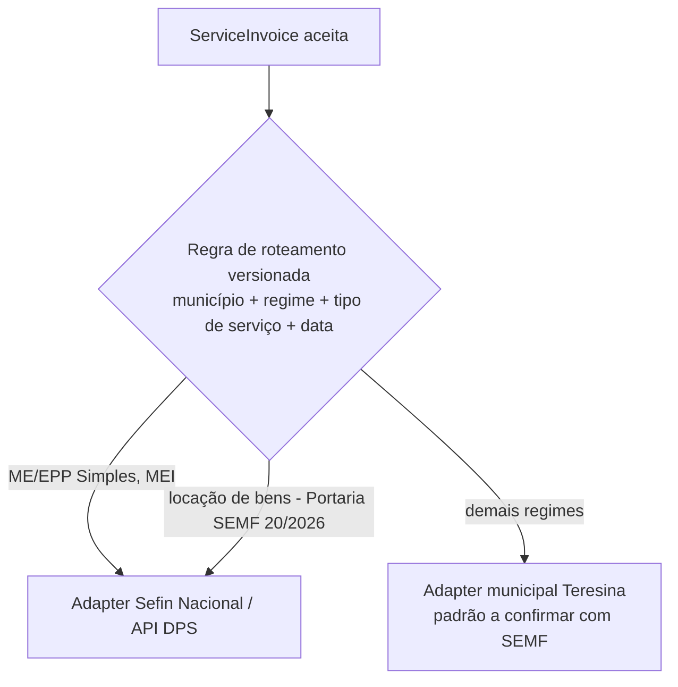

# Investigação — NFS-e em Teresina/PI

> Consulta realizada em 2026-11-09. Fontes secundárias estão marcadas como tal e
> **precisam de confirmação oficial** (SEMF Teresina / gov.br/nfse) antes de virarem regra no código.

## 1. Constatações

| # | Constatação | Fonte | Confiabilidade |
|---|---|---|---|
| T1 | ME e EPP optantes do Simples Nacional devem emitir NFS-e pelo **Emissor Nacional (web ou API)** a partir de **01/11/2026** (Resolução CGSN nº 189/2026, data alterada pela Resolução CGSN nº 191/2026, que adiou de 01/09 para 01/11). | [Receita Federal — notícia abr/2026](https://www.gov.br/receitafederal/pt-br/assuntos/noticias/2026/abril/nfs-e-de-padrao-nacional-sera-obrigatoria-para-optantes-do-simples-nacional); [Contábeis](https://www.contabeis.com.br/noticias/80380/simples-nacional-tera-nfs-e-nacional-obrigatoria-a-partir-de-novembro/); [FecomercioSP](https://fecomercio.com.br/ultimas-postagens/nfs-e-nacional-sera-obrigatoria-para-o-simples-a-partir-de-novembro/) | Oficial (notícia RFB) + secundárias. **Ler o texto das resoluções.** |
| T2 | A obrigação alcança também empresas com opção pelo Simples pendente/em discussão com possibilidade de inclusão retroativa; é vedado usar a NFS-e nacional para operações sujeitas apenas ao ICMS. | [Contábeis](https://www.contabeis.com.br/noticias/80380/simples-nacional-tera-nfs-e-nacional-obrigatoria-a-partir-de-novembro/) | Secundária |
| T3 | Teresina mantém **emissor municipal próprio** (notafiscal.teresina.pi.gov.br) com base no art. 62 da LC 214/2025, e atualizou o sistema para se adequar ao modelo nacional / ficar apta a compartilhar com o repositório nacional. | [LegisWeb](https://www.legisweb.com.br/noticia/?id=32246); [GP1, ago/2025](https://www.gp1.com.br/pi/piaui/noticia/2025/8/5/teresina-atualiza-sistema-de-nota-fiscal-de-servicos-para-adequacao-ao-modelo-nacional-600772.html); [Cidade Verde](https://cidadeverde.com/contabilidade/132676/nfs-e-em-teresina-confira-as-mudancas) | Secundária (imprensa) |
| T4 | Portaria SEMF nº 20/2026: locação de bens emitida no **ambiente nacional**, temporariamente, até o emissor local registrar fatos geradores de IBS/CBS. | [TOTVS](https://www.totvs.com/blog/fiscal-clientes/reforma-tributaria-teresina-orienta-emissao-de-nfs-e-para-locacao-de-bens/) | Secundária — ler a portaria |
| T5 | O sistema municipal de Teresina seria do padrão **DSF**, com webservice autenticado por certificado A1. | [Actana](https://actana.com.br/como-emitir-nota-fiscal-teresina); [Sisloc](https://atendimento.sisloc.com.br/hc/pt-br/articles/202465854-Existem-informa%C3%A7%C3%B5es-espec%C3%ADficas-sobre-a-NFS-e-para-Teresina-PI-Quais) | **Baixa** (comercial) — exige manual oficial da SEMF |
| T6 | A API do contribuinte (Sefin Nacional) tem recepção de DPS em XML, consulta de NFS-e pela chave de acesso e uma **API DPS que retorna a chave de acesso a partir do identificador da DPS**. Manual vigente encontrado: "Manual Contribuintes — Emissor Público API — Sistema Nacional NFS-e v1.2 (out/2025)". | [gov.br/nfse — manual v1.2](https://www.gov.br/nfse/pt-br/biblioteca/documentacao-tecnica/documentacao-atual/manual-contribuintes-emissor-publico-api-sistema-nacional-nfs-e-v1-2-out2025.pdf/@@download/file) | Oficial — **leitura integral pendente** |
| T7 | Leiaute da Reforma Tributária na DPS: NT 004 SE/CGNFS-e (novo leiaute RTC v2.00, 10/12/2025); NT 007 SE/CGNFS-e. | [NT 004](https://www.gov.br/nfse/pt-br/biblioteca/documentacao-tecnica/rtc-producao-restrita-piloto/nt-004-se-cgnfse-novo-layout-rtc-v2-00-20251210.pdf); [NT 007](https://www.gov.br/nfse/pt-br/biblioteca/documentacao-tecnica/rtc/nt-007-se-cgnfse-v1-0.pdf) | Oficial — leitura pendente |

## 2. Consequência para a arquitetura

Teresina terá **dois caminhos de integração** para NFS-e, decididos pelo regime do estabelecimento e pelo tipo de serviço — exatamente o cenário que a porta `NfseGateway` + adapters previa:

- A regra de roteamento é **dado versionado com vigência e fonte** (ADR-0013), não `if` no código: ela vai mudar quando Teresina aderir ou habilitar IBS/CBS no emissor local.
- O roteamento é decidido e **gravado na aceitação** do documento; consultas e cancelamentos posteriores usam o mesmo adapter.

## 3. Ordem de implementação recomendada
1. **Fase 2a — API Nacional (Simples ME/EPP em Teresina)**: obrigação já vigente, documentação oficial nacional disponível, maior reuso para outros municípios.
2. **Fase 2b — Emissor municipal de Teresina (outros regimes)**: somente após obter o **manual oficial do webservice** junto à SEMF.

## 4. Limitação importante sobre "dados fictícios"
- Dados fictícios servem para testes unitários, de integração e para o simulador local.
- O **ambiente oficial de homologação/produção restrita** autentica por mTLS com **certificado ICP-Brasil real** de um CNPJ real. Não é possível validar a integração oficial só com uma empresa fictícia. Precisaremos de um CNPJ real (de preferência sua própria empresa) e do certificado A1 dela no ambiente de produção restrita, com conteúdo das notas fictício. Confirmar as regras de acesso à produção restrita no manual.

## 5. Ponto de atenção operacional
Se alguma das suas empresas for ME/EPP do Simples prestadora de serviço, ela **já está obrigada** desde 01/11/2026. Até o motor entrar em produção, a emissão deve seguir pelo Emissor Nacional web (gratuito) ou pela solução atual.

## 6. Perguntas para a SEMF / especialista fiscal
1. Teresina tem convênio/adesão formal ao Sistema Nacional NFS-e? Desde quando compartilha dados com o ADN?
2. Manual oficial do webservice municipal (padrão, versão, ambientes de homologação, autenticação).
3. Cronograma de habilitação de IBS/CBS no emissor local.
4. Regras de cancelamento/substituição no emissor municipal.
5. Contribuinte do regime normal pode optar pelo emissor nacional em Teresina?
