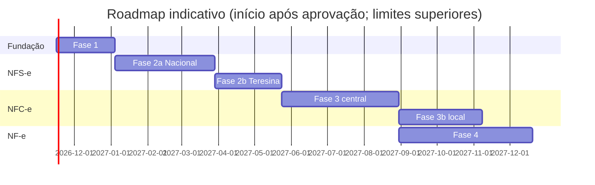

# Roadmap de implementação (revisado em 2026-11-09)

**Premissas**: 1 desenvolvedor principal + agente de código; especialista fiscal pontual
(revisões nos *gates* fiscais). Semanas de trabalho efetivo. A maior incerteza é
fiscal/externa (documentação, acesso à produção restrita, resposta da SEMF, comportamento
real dos autorizadores), por isso cada fase tem folga explícita.

| Fase | Escopo | Estimativa | Gate de saída |
|---|---|---|---|
| 0 | Arquitetura (esta entrega) | concluída | aprovação do responsável |
| 1 | Fundação | **5–7 semanas** | fluxo completo com documento fake + testes de isolamento, idempotência, concorrência e falhas passando no CI; spikes aprovados |
| 2a | NFS-e Nacional — ME/EPP Simples, Teresina | **8–12 semanas** | suíte de contrato aprovada em produção restrita; revisão do especialista fiscal; piloto controlado |
| 2b | NFS-e emissor municipal Teresina (demais regimes) | **4–8 semanas** (depende de obter o manual oficial da SEMF) | idem 2a no ambiente municipal |
| 3 | NFC-e Piauí — motor central | **10–14 semanas** | homologação SEFAZ-PI; integração NERP online; contingência central conforme MOC |
| 3b | Contingência local NERP/Tauri | **6–10 semanas** (somente após 3 validada em produção) | ADR de segurança do desktop aprovado; testes offline → sincronização |
| 4 | NF-e modelo 55 | **12–16 semanas** | homologação; eventos, inutilização, contingência SVC/EPEC conforme MOC |
| 5 | Robustez e expansão | contínuo | — |

**Total até NF-e em produção**: ~45–67 semanas (≈ 11–16 meses), sem contar 3b em paralelo.
Comparado à versão anterior, aumentou por: equipe de uma pessoa, NFS-e em dois caminhos
(nacional + municipal), Fase 3b separada e mais testes de isolamento/recuperação na fundação.

## Fase 1 — detalhamento (5–7 semanas)
| Semana | Entregas |
|---|---|
| 1 | Repositório, TS strict, lint, regras de dependência, Vitest, Docker Compose (Postgres + S3 local), CI. **Spikes**: XMLDSig verificado por `xmlsec1`; PKCS#12 + mTLS com undici e classificação de fase de falha; validação XSD; pg-boss transacional |
| 2 | Config, logger com redaction + teste canário, correlation id, erros RFC 9457, health/readiness |
| 3 | Drizzle + migrations + papéis de banco + RLS + meta-teste de schema + UnitOfWork + Testcontainers |
| 4 | IAM (API keys, escopos, grants) + Company + Fiscal Settings (alocação concorrente de numeração) + matriz de isolamento da API |
| 5 | Certificate Vault (KEK assimétrica, validação no worker-fiscal, grants de coluna) + Audit log encadeado; API de certificados só com metadados (thumbprint, validade, status, troca com sobreposição — ADR-0027) |
| 6 | Fila, outbox, write-ahead de tentativas, stuck-scan, reconciliador genérico, webhooks HMAC (com calendário de retentativas publicado e reenvio por documento), endpoints `ops`, **rate limit por credencial** (429 + `Retry-After`), catálogo de eventos e filtros por assinatura de webhook (ADR-0027) |
| 7 | Folga + deploy no Coolify (api, worker-fiscal, worker-general, postgres), backup WAL, runbooks iniciais, **changelog e política de descontinuação da API**, `dryRun` nos cadastros, habilitação de produção por estabelecimento e modalidade, OpenAPI em URL estável + `llms.txt` (ADR-0027) |

## Fase 2a — detalhamento (8–12 semanas)
1. Leitura integral do manual API v1.2, leiautes, NTs 004/007 e resoluções CGSN; registro em `fontes-oficiais.md`; catálogo de regras → **gate fiscal 1** (especialista).
2. Domínio `ServiceInvoice`/DPS, regras L2/L3 com testes, roteamento Teresina. Contrato da API com as convenções do [ADR-0026](adr/0026-convencoes-api-referencia-mercado.md): `externalReference` permanente + consulta por referência, 201 × 202 com `Prefer: wait`, ambiente derivado da credencial, `authorizerStatus`, `hint` nas rejeições, endpoint de validação sem efeitos, `include=`, tabela oficial de municípios do IBGE. Inscrição municipal como recurso do estabelecimento e download do XML de rejeição (ADR-0027).
3. Geração XML, assinatura, XSD, adapter Sefin Nacional, simulador alimentado por capturas reais.
4. Emissão, consulta (API DPS), cancelamento, substituição (se aplicável), DANFSe conforme padrão.
5. Produção restrita com CNPJ/certificado reais e dados fictícios → **gate fiscal 2**.
6. Piloto em produção com uma empresa, volume limitado, monitoramento diário.

## Fase 3 — itens vindos da análise da NFE.io ([doc 17](architecture/17-referencia-nfe-io.md), ADR-0027)
- Inscrição estadual por estabelecimento e modelo, com CSC da NFC-e no cofre.
- Estratégia de contingência configurável (`MANUAL`/`AUTOMATIC`), só após a leitura do MOC.
- Inutilização por faixa com comprovante; downloads de XML de eventos (cancelamento, CC-e, inutilização).

## Fase 5 — itens vindos da análise de mercado ([doc 16](architecture/16-referencia-focus-nfe.md))
- Exportação mensal de XMLs por estabelecimento para o contador (ZIP por link pré-assinado).
- Documentos recebidos (distribuição DF-e e manifestação do destinatário).
- Credenciais restritas a empresas específicas.
- SDK TypeScript gerado do OpenAPI para Orbita e NERP (avaliar após a Fase 2a).

## Dependências externas que podem atrasar
- Acesso à produção restrita da NFS-e (CNPJ + certificado reais).
- Manual oficial do webservice de Teresina (SEMF).
- Disponibilidade do especialista fiscal nos gates.
- NTs novas da Reforma Tributária durante o desenvolvimento.

