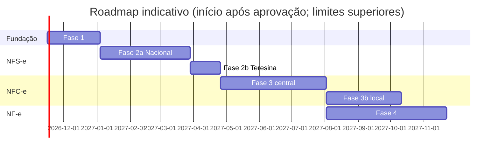

# Roadmap de implementação (revisado em 2026-11-09)

**Premissas**: 1 desenvolvedor principal + agente de código; especialista fiscal pontual
(revisões nos *gates* fiscais). Semanas de trabalho efetivo. A maior incerteza é
fiscal/externa (documentação, acesso à produção restrita, resposta da SEMF, comportamento
real dos autorizadores), por isso cada fase tem folga explícita.

| Fase | Escopo | Estimativa | Gate de saída |
|---|---|---|---|
| 0 | Arquitetura (esta entrega) | concluída | aprovação do responsável |
| 1 | Fundação | **5–7 semanas** | fluxo completo com documento fake + testes de isolamento, idempotência, concorrência e falhas passando no CI; spikes aprovados |
| 2a | NFS-e Nacional — ME/EPP Simples, Teresina | **8–12 semanas** | suíte de contrato aprovada em produção restrita; revisão do especialista fiscal; piloto controlado |
| 2b | NFS-e emissor municipal Teresina (DSF; Lucro Presumido/Real e competências < 11/2026) | **2–4 semanas** (contrato oficial já publicado no Guia API THE V7; reaproveita o cliente do padrão nacional, ADR-0029). Prioridade conforme o perfil de regime dos clientes | idem 2a na homologação municipal |
| 3 | NFC-e Piauí — motor central | **10–14 semanas** | homologação SEFAZ-PI; integração NERP online; contingência central conforme MOC |
| 3b | Contingência local NERP/Tauri | **6–10 semanas** (somente após 3 validada em produção) | ADR de segurança do desktop aprovado; testes offline → sincronização |
| 4 | NF-e modelo 55 | **12–16 semanas** | homologação; eventos, inutilização, contingência SVC/EPEC conforme MOC |
| 5 | Robustez e expansão | contínuo | — |

**Total até NF-e em produção**: ~45–67 semanas (≈ 11–16 meses), sem contar 3b em paralelo.
Comparado à versão anterior, aumentou por: equipe de uma pessoa, NFS-e em dois caminhos
(nacional + municipal), Fase 3b separada e mais testes de isolamento/recuperação na fundação.

## Fase 1 — detalhamento (5–7 semanas)
| Semana | Entregas |
|---|---|
| 1 | Repositório, TS strict, lint, regras de dependência, Vitest, Docker Compose (Postgres + S3 local), CI. **Spikes**: XMLDSig verificado por `xmlsec1`; PKCS#12 + mTLS com undici e classificação de fase de falha; validação XSD; pg-boss transacional |
| 2 | Config, logger com redaction + teste canário, correlation id, erros RFC 9457, health/readiness |
| 3 | Drizzle + migrations + papéis de banco + RLS + meta-teste de schema + UnitOfWork + Testcontainers |
| 4 | IAM (API keys, escopos, grants) + Company + Fiscal Settings (alocação concorrente de numeração) + matriz de isolamento da API |
| 5 | Certificate Vault (KEK assimétrica, validação no worker-fiscal, grants de coluna) + Audit log encadeado; API de certificados só com metadados (thumbprint, validade, status, troca com sobreposição — ADR-0027) |
| 6 | Fila, outbox, write-ahead de tentativas, stuck-scan, reconciliador genérico, webhooks HMAC (com calendário de retentativas publicado e reenvio por documento), endpoints `ops`, **rate limit por credencial** (429 + `Retry-After`), catálogo de eventos e filtros por assinatura de webhook (ADR-0027) |
| 7 | Folga + deploy no Coolify (api, worker-fiscal, worker-general, postgres), backup WAL, runbooks iniciais, **changelog e política de descontinuação da API**, `dryRun` nos cadastros, habilitação de produção por estabelecimento e modalidade, OpenAPI em URL estável + `llms.txt` (ADR-0027) — **código concluído em 2026-11-11** (mais avisos de vencimento e âncora externa da auditoria, ADR-0031); deploy real aguardando VPS, domínio e buckets |
| 8 (encerramento) | Spikes 01–03 promovidos a código definitivo (XSD oficial, assinatura, mTLS) e apagados; pg-boss removido — **concluído em 2026-11-11**. O "fluxo completo com documento fake" do gate foi reescopado para a Fase 2a, junto com o write-ahead e o reconciliador (semana 6) |

## Fase 2a — detalhamento (8–12 semanas)
Diagnóstico de base: [nfse-teresina-api-municipal-x-nacional.md](fiscal/nfse-teresina-api-municipal-x-nacional.md). Decisões: ADR-0017 (revisado), ADR-0028 (roteamento por competência) e ADR-0029 (transmissão e reconciliação). XSD de produção e de produção restrita já versionados em `resources/fiscal/schemas/nfse-nacional/`.

0. Pré-requisitos do responsável: CNPJ e A1 reais (leitura do Swagger da SEFIN); enquadramento da empresa-piloto confirmado pelo contador (`opSimpNac`, `regApTribSN`, `cTribNac`/NBS, alíquota); perguntas à SEMF (§10 do diagnóstico).
1. ~~Leitura do manual API v1.2, leiautes e resoluções CGSN~~ (feita em 2026-11-10). Falta: Swagger, aba de regras do Anexo II (prazo de cancelamento), catálogo de regras → **gate fiscal 1** (especialista).
2. ~~Núcleo da emissão: `ServiceInvoice`, máquina de estados, Id da DPS, aceite idempotente, write-ahead, reconciliação e simulador ([ADR-0032](adr/0032-nucleo-emissao-nfse.md))~~: **concluído em 2026-11-12**. ~~Contrato da DPS na API e preparador real ([ADR-0033](adr/0033-contrato-dps-v1.md))~~: **concluído em 2026-11-12**. ~~Resolução manual de `UNKNOWN` e alertas por idade ([ADR-0034](adr/0034-resolucao-manual-unknown.md))~~: **concluído em 2026-11-12**. ~~Roteamento Teresina (ADR-0028)~~: **concluído em 2026-11-12**. ~~Cancelamento (e101101, [ADR-0035](adr/0035-cancelamento-nfse.md))~~: **concluído em 2026-11-12**. ~~Substituição ([ADR-0036](adr/0036-substituicao-nfse.md))~~: **concluído em 2026-11-13**. ~~Regras do Anexo I que dependem só da DPS ([ADR-0037](adr/0037-regras-anexo-i-no-aceite.md))~~: **concluído em 2026-11-13**. ~~Adapter da SEFIN Nacional, produção restrita ([ADR-0038](adr/0038-adapter-sefin-nacional.md))~~: **concluído em 2026-11-13**; o primeiro envio real parou na E0037 (R-43). ~~Adapter do emissor municipal de Teresina, homologação ([ADR-0039](adr/0039-adapter-emissor-municipal-teresina.md), adiantado da Fase 2b)~~: **concluído em 2026-11-13**; falta o primeiro envio. Falta (prioridade pelo R-42): contrato v2 com endereço do tomador, intermediário e `tpImunidade`, depois deduções e IBS/CBS; regras L3 que dependem de cadastro ou parametrização ficam com o autorizador, contrato v2 (endereço, intermediário, deduções, IBS/CBS). Contrato da API com as convenções do [ADR-0026](adr/0026-convencoes-api-referencia-mercado.md): `externalReference` permanente + consulta por referência, 201 × 202 com `Prefer: wait`, ambiente derivado da credencial, `authorizerStatus`, `hint` nas rejeições, endpoint de validação sem efeitos, `include=`, tabela oficial de municípios do IBGE. Inscrição municipal como recurso do estabelecimento e download do XML de rejeição (ADR-0027).
3. Geração XML, assinatura, XSD, adapter Sefin Nacional, simulador alimentado por capturas reais.
4. Emissão, consulta (API DPS), cancelamento, substituição (se aplicável), DANFSe conforme padrão.
5. Produção restrita com CNPJ/certificado reais e dados fictícios → **gate fiscal 2**.
6. Piloto em produção com uma empresa, volume limitado, monitoramento diário.

## Fase 3 — itens vindos da análise da NFE.io ([doc 17](architecture/17-referencia-nfe-io.md), ADR-0027)
- Inscrição estadual por estabelecimento e modelo, com CSC da NFC-e no cofre.
- Estratégia de contingência configurável (`MANUAL`/`AUTOMATIC`), só após a leitura do MOC.
- Inutilização por faixa com comprovante; downloads de XML de eventos (cancelamento, CC-e, inutilização).

## Fase 5 — itens vindos da análise de mercado ([doc 16](architecture/16-referencia-focus-nfe.md))
- Exportação mensal de XMLs por estabelecimento para o contador (ZIP por link pré-assinado).
- Documentos recebidos (distribuição DF-e e manifestação do destinatário).
- Credenciais restritas a empresas específicas.
- SDK TypeScript gerado do OpenAPI para Orbita e NERP (avaliar após a Fase 2a).

## Dependências externas que podem atrasar
- Acesso à produção restrita da NFS-e (CNPJ + certificado reais).
- ~~Manual oficial do webservice de Teresina (SEMF)~~: publicado (Guia API THE V7). Ainda faltam as respostas da SEMF às perguntas do diagnóstico.
- Disponibilidade do especialista fiscal nos gates.
- NTs novas da Reforma Tributária durante o desenvolvimento.

